<p align="center">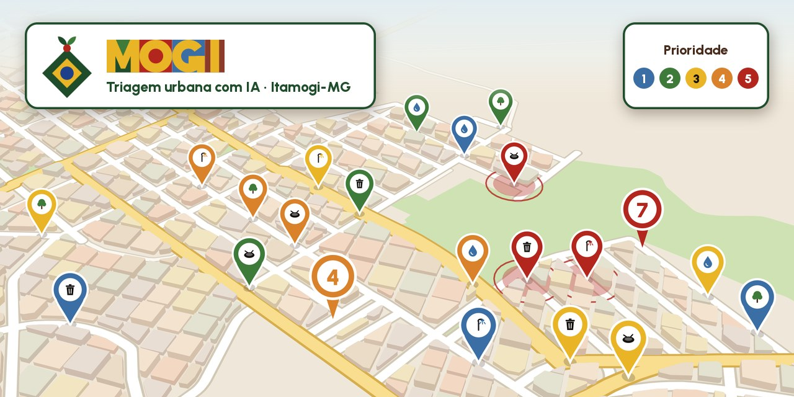</p>

<p align="center"><b>Triagem urbana com IA para Itamogi-MG:</b> o morador fotografa o problema, o MOGI dá a prioridade de 1 a 5 e a prefeitura vê tudo ao vivo no mapa.</p>

 [](LICENSE)     

# Sistema MOGI
**Monitoramento e Ocorrências com Gestão Inteligente.** Piloto de cidade inteligente em Itamogi-MG, time ROTA Scale, AKCIT Camp Sul 2026 (hackathon de 21/11/2026). O nome faz referência a Itamogi.

**Final de 28/11/2026:** [pitch de 5 minutos em PDF](pitch/mogi-pitch-final.pdf) · [página do pitch, com os vídeos](https://rota-scale.github.io/sistema-mogi/) · [vídeo do protótipo](brand/showcase/mogi-showcase.mp4)

**Para a banca:** [pitch](pitch/README.md) · [BMC e impacto](bmc/README.md) · [MOGI frente ao legado](docs/legado-vs-mogi.md) · [tempo economizado](docs/economia-de-tempo.md) · [fluxo do agente](docs/fluxo-do-agente.md) · [visão enterprise](docs/enterprise/README.md) · [checklist AKCIT](docs/checklist-akcit.md)

## Em 30 segundos
- **O problema:** em cidade pequena, buraco, cano estourado e poste apagado chegam por telefone e WhatsApp, sem foto, sem endereço e sem ordem de urgência. O urgente se perde no meio do comum.
- **O MOGI:** o morador aponta a câmera; a IA e uma regra da prefeitura dão a urgência de 1 a 5 com o motivo; a central confere, a equipe resolve com foto e o morador acompanha.
- **Canais:** o morador vai poder relatar por um assistente no WhatsApp, sem baixar nada, porque é onde ele já está. O app do MOGI continua com mais funções para o morador e com os perfis de gestor, operador e equipe. O assistente de WhatsApp é próximo passo, ainda não está no protótipo.
- **Piloto:** Itamogi-MG. Prazos e secretarias são proposta, a validar com a prefeitura.
- **Versão atual:** v0.3.3 ([o que mudou](CHANGELOG.md)).

## O que já foi validado
Em 18/11/2026 o prefeito de Itamogi avaliou o protótipo em reunião. Gravamos um vídeo dele falando sobre o sistema, que está na [página do pitch](https://rota-scale.github.io/sistema-mogi/). Ainda não houve teste prático com morador. Esse teste é o próximo passo, com relatos reais feitos no município.

Os números abaixo foram medidos pelo time em 15/11/2026, com casos escritos por nós, não em Itamogi. Não são resultado de campo. Fonte, data e amostra de cada um: [registro de evidências](docs/evidencias.md).

| Triagem | Custo da IA | Acerto no teste do time | Tempo devolvido à prefeitura |
|:-:|:-:|:-:|:-:|
| **160 ms** | **R$ 0,0003** por relato | **10 de 11** casos fictícios | **~230 h/mês** com 400 pedidos (estimativa) |

## Veja em 90 segundos
<p align="center"><a href="brand/showcase/mogi-showcase.mp4">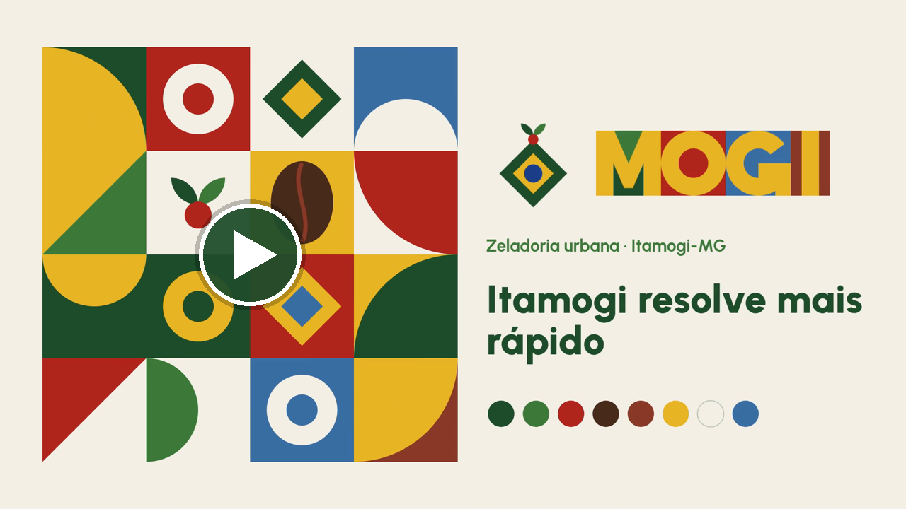</a></p>

<sub>Clique na imagem: o vídeo abre no player do GitHub (85 s, com som). Telas reais do sistema; cenas de rua geradas por IA e marcadas no vídeo. Detalhes em [brand/showcase](brand/showcase/README.md).</sub>

## Casos de uso
<p align="center">
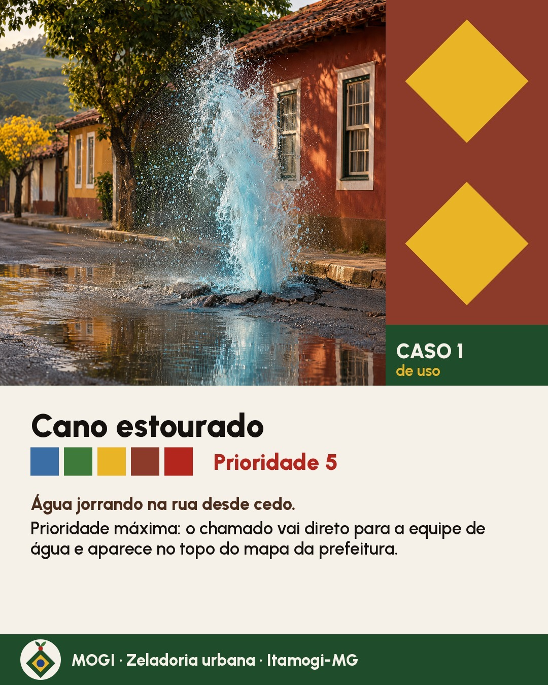
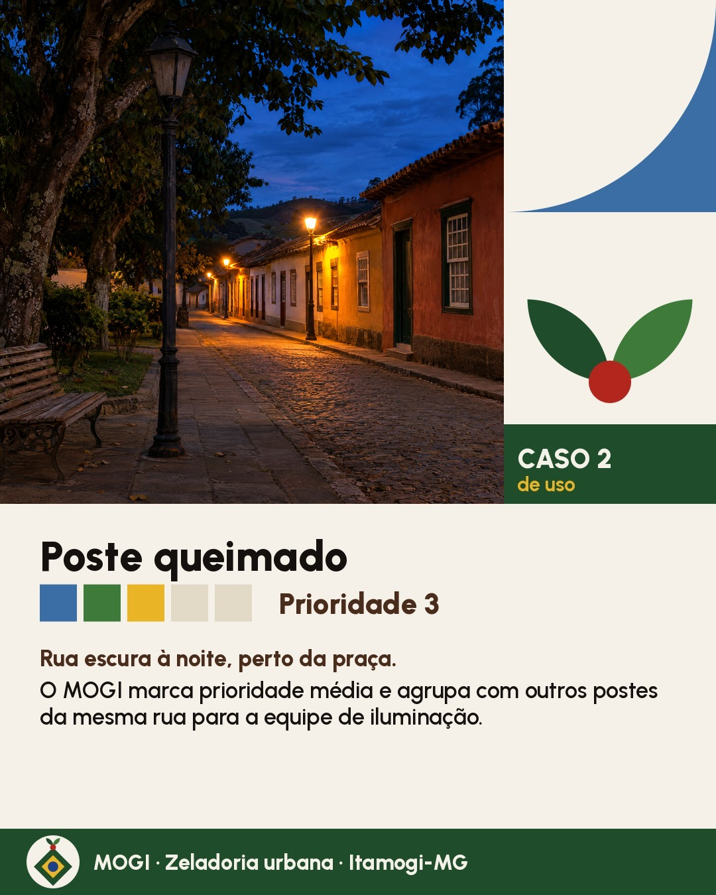
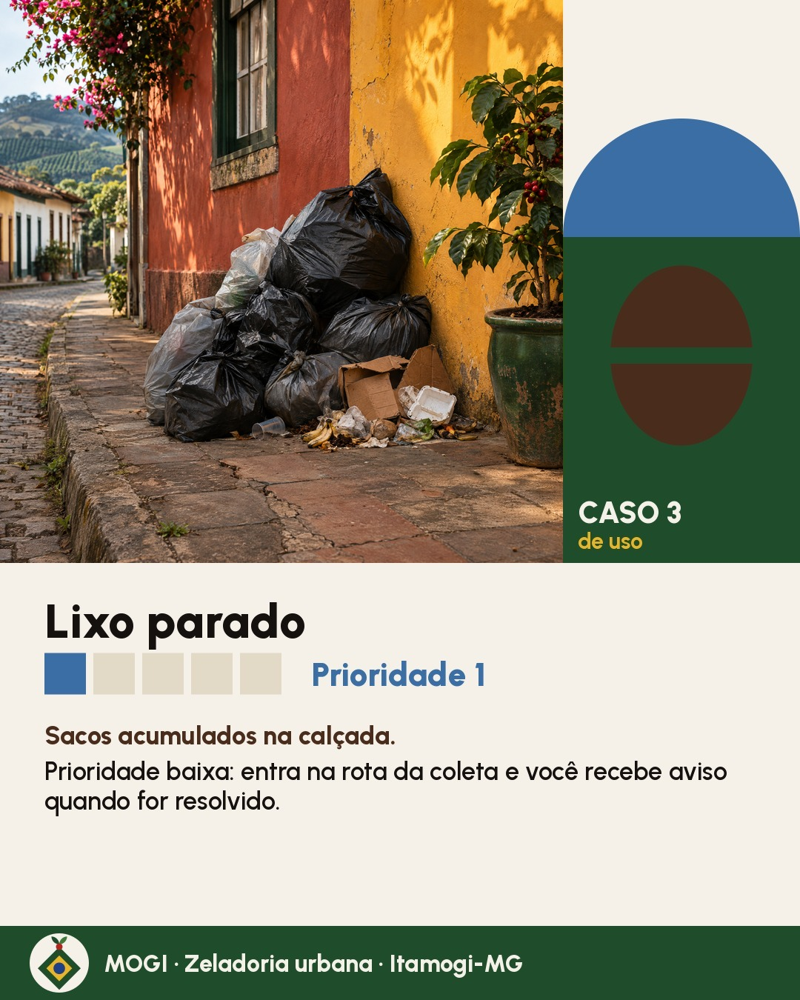
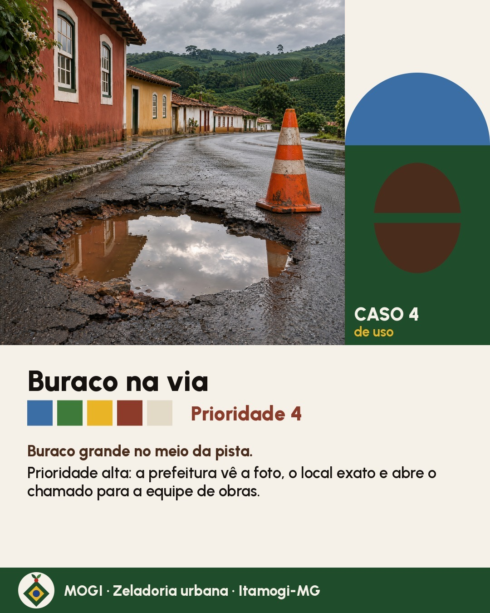
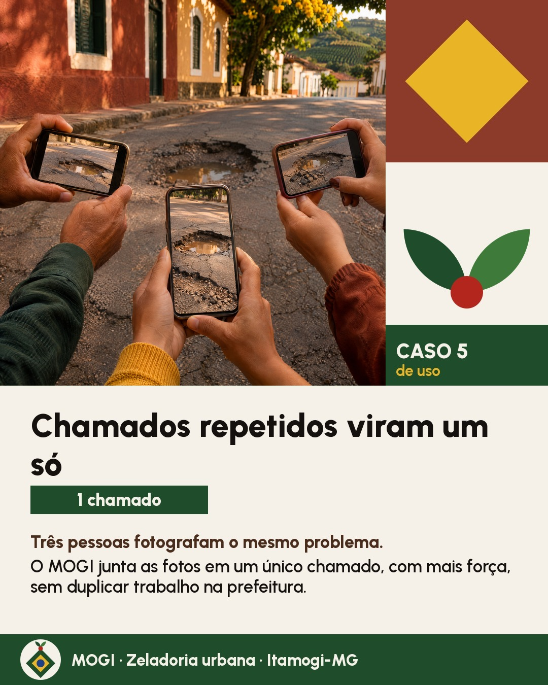
</p>

<sub>Imagens geradas por IA, não fotos de Itamogi. As fotos reais vêm do teste de campo.</sub>

## As telas
<p align="center">
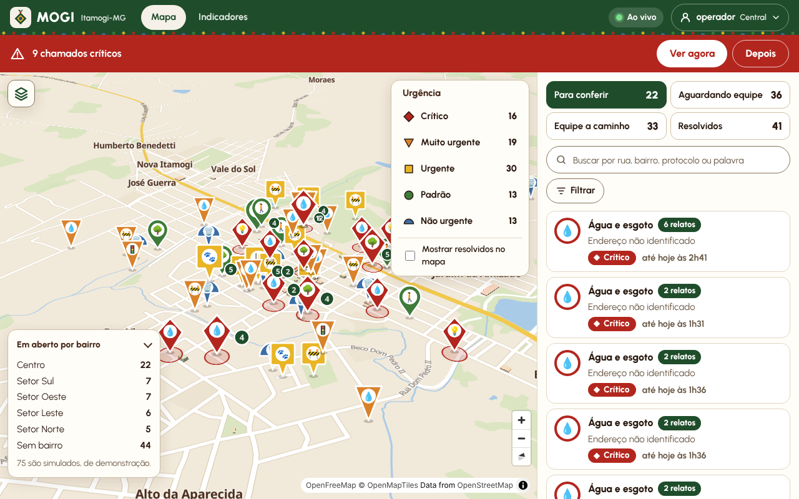
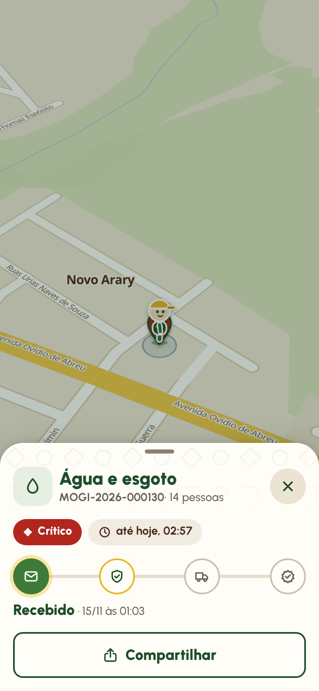
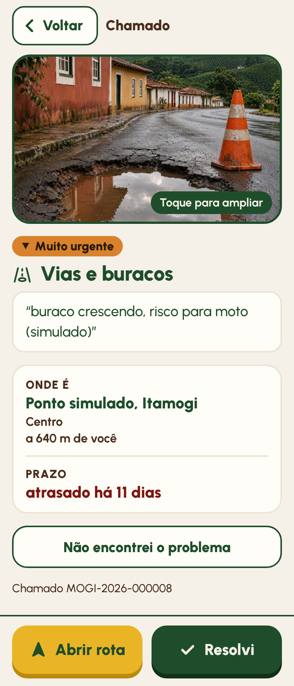
</p>

<sub>Central (`/`), morador (`/relatar`) e equipe de campo (`/campo`). Os pinos são relatos simulados, marcados assim no painel.</sub>

**Primeiro contato pensado para quem não lida com tecnologia:**
- **Morador:** 3 slides de boas-vindas, cadastro em 2 passos (dados, depois os termos de ciência), bairro pelo GPS e tour no mapa de verdade.
- **Boneco do mapa:** escolhido pelo sexo e pela idade informados no cadastro, ou no Perfil.
- **Prefeitura:** operador, gestor e equipe de campo ganham um guia curto no primeiro acesso.

Tudo pode ser revisto pela Ajuda.

## Como o agente de IA funciona
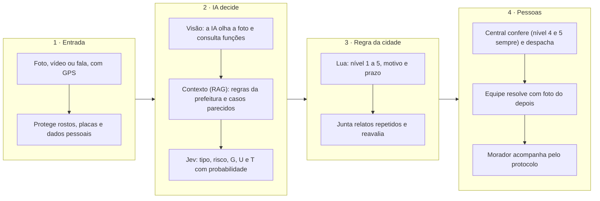

Se uma etapa de IA falha, a próxima assume: Jev, depois a IA de reserva, depois o classificador local, e por último uma pessoa. Nenhum relato se perde.

| | |
|---|---|
| **Entra** | até 4 fotos ou um vídeo de 15 s sem som, fala ou texto, e o GPS |
| **Decide** | a IA vê a foto e consulta o contexto da cidade; o Jev dá as probabilidades; a regra Lua da prefeitura fixa nível, motivo e prazo; uma pessoa confere os níveis 4 e 5 |
| **Sai** | recibo e acompanhamento para o morador, pino ao vivo para a central, chamado com rota para a equipe, indicadores e auditoria para o gestor |

<details>
<summary><b>Detalhe: entradas, cada etapa com limiar, saídas e por que a IA não decide sozinha</b></summary>

### Inputs: o que entra
| O que | De quem | Formato |
|---|---|---|
| Fotos do problema | morador | 1 a 4 fotos JPEG ou PNG, até 12 MB cada |
| Vídeo curto | morador (opcional) | 1 vídeo MP4, MOV ou WebM, até 15 s e 25 MB, **sem som**, com até 3 quadros extraídos no aparelho |
| Fala ou texto | morador (opcional) | texto até 1.000 caracteres; a fala é transcrita no aparelho e o áudio não chega ao servidor |
| Localização | GPS do celular, ou ponto marcado no mapa | `lat`, `lng` e precisão em metros |
| Categoria | morador (opcional) | uma de 9; com a IA vendo a foto, pode ficar em branco |
| Chave do envio e do aparelho | app | UUIDs aleatórios: evitam duplicar o relato e limitam abuso, sem identificar a pessoa |
| Regras e parâmetros da cidade | gestor da prefeitura | scripts Lua e parâmetros editados no painel |
| Ações da prefeitura | central e equipe de campo | conferir, despachar, resolver com foto do depois, reabrir |

### Lógica: cada etapa e quem decide
| Etapa | O que faz | É IA ou regra? | Limiar |
|---|---|---|---|
| 1. Borrão | detecta e borra rostos e placas em cada foto; se falhar, borra a foto inteira | algoritmo determinístico (detector Pigo e heurística de placas) | |
| 2. Texto limpo | troca e-mail, CPF, telefone e placa por `[removido]` | regra de texto | |
| 3. Endereço | GPS vira rua e bairro (Nominatim) | serviço de mapa | 5 s |
| 4. Visão | olha a foto (rostos e placas já protegidos) e descreve o problema; a IA pode **chamar funções** (chamados abertos perto, casos parecidos, orientação da prefeitura) antes de responder | **IA** (Jev com foto, ou LLM com visão de reserva) | 20 s; até 3 voltas |
| 4b. Contexto (RAG) | busca na base de orientações da prefeitura e no histórico da cidade o que ajuda a decidir, e manda junto para o classificador, sem coordenada nem dado pessoal | **agente de contexto**, busca local (BM25 e texto em português no Postgres) | 800 ms |
| 5. Classificação | responde: que tipo de problema, há mesmo um problema, sinais de risco (água jorrando, fio exposto, perto de escola...), gravidade, urgência e tendência de 1 a 5, cada um com probabilidade | **IA**: Jev, depois IA de reserva, depois classificador local | 15 s por tentativa |
| 6. Conferência | recusa saída fora do esquema (categoria desconhecida, probabilidades inválidas) e passa ao próximo | regra em Go | |
| 7. GUT | calcula a nota esperada e a pessimista (p90) de G x U x T | conta determinística | |
| 8. Nível e prazo | o script Lua da prefeitura escolhe o nível pela faixa da GUT e sobe o nível quando um sinal crítico está claro; o prazo sai do nível | **regra auditável**, editável pela prefeitura | sinal acima de 0,8; confiança 0,6; 50 ms |
| 9. Agrupamento | relato da mesma categoria a até 50 m de um chamado aberto entra nele; a tendência sobe 35% por relato extra e a regra roda de novo | regra (PostGIS) | 50 m e 30 dias |
| 10. Revisão humana | vai para uma pessoa se o nível é 4 ou 5, a confiança está abaixo de 0,6, a foto não serve ou o relato provavelmente não é um problema | **humano** | confiança 0,6; não abaixo de 0,3 |
| 11. Despacho e resolução | a central despacha para a secretaria; a equipe resolve e prova com foto | **humano** | |

Se tudo falhar, o relato não se perde: fica "a classificar" e vai para a revisão humana.

### Outputs: o que sai
| Para quem | O que recebe |
|---|---|
| Morador | recibo na hora com protocolo, nível, prazo e o endereço do próprio ponto; acompanhamento em quatro passos (recebido, conferido, equipe a caminho, resolvido) com o que foi feito e a foto do depois; "Perto de você" com "Também vi" |
| Central (operador) | pino ao vivo no mapa, com som de crítico no nível 5; fila por nível; detalhe com a foto (rostos e placas protegidos), urgência em uma linha e o motivo em frase; botão principal conforme a situação |
| Equipe de campo | lista dos chamados da própria secretaria, rota até o ponto, resolver com foto do depois ou "não encontrei" |
| Gestor | indicadores (tempo até despacho e resolução por nível, no prazo, acerto da IA contra o operador, custo e latência), aba Operação, relatório CSV, editor de regras, usuários e parâmetros |
| Auditoria | motivo da regra em cada chamado, linha por etapa da triagem com provedor, tempo, tokens e custo (`triagem_etapas`), histórico de cada ação (`eventos`), histórico de regras e parâmetros, registro de quem abriu cada vídeo |

### Por que a IA não decide sozinha o nível
- **Julgamentos pequenos e tipados.** A IA não escreve "nível 5". Ela responde perguntas fechadas ("há água jorrando?", "quão grave de 1 a 5?") com probabilidade. Cada resposta é verificada contra um esquema; resposta fora do formato é descartada.
- **A decisão é da prefeitura, numa regra que qualquer um lê.** O nível sai de um script Lua curto, que o gestor edita no painel, testa em 13 cenários antes de salvar e que fica com histórico de quem mudou. O motivo vai escrito em cada chamado.
- **Uma pessoa no circuito.** Todo nível 4 e 5, e toda dúvida, passa por um servidor antes de virar atendimento. O nível só sobe sozinho; baixar é decisão humana.
- **Sem dependência de um fornecedor.** Se o Jev cair, a IA de reserva assume; se ela cair, o classificador local; se tudo cair, uma pessoa decide.

</details>

## A regra da prefeitura em Lua
A urgência sai de um script curto que o gestor lê, testa e edita no painel, sem programador. Lua foi criada no Brasil, na PUC-Rio.

```lua
-- Água e esgoto: cano estourado, vazamento, esgoto a céu aberto.
function avaliar(t)
  return avaliar_padrao(t, {
    { sinal = "agua_jorrando",   nivel = 5 },
    { sinal = "alagamento",      nivel = 5 },
    { sinal = "perto_de_escola", nivel = 4 },
  })
end
```

Se a IA tiver mais de 80% de certeza de água jorrando, o nível é no mínimo 5; perto de escola, no mínimo 4. Detalhe em [fluxo do agente](docs/fluxo-do-agente.md#a-regra-da-prefeitura-em-lua) e [SOP 03](docs/sops/03-regra-lua.md).

## O que o hackathon pede, e onde está
LLM com visão, classificação tipada, orquestração, multiagentes, RAG e function calling: **todos no código, com teste** ([ADR 0023](docs/adr/0023-agente-de-contexto-rag-e-function-calling.md)).

<details>
<summary><b>Ver onde cada um está no código</b></summary>

| Conteúdo | Situação | Onde está |
|---|---|---|
| **LLM com visão e saída estruturada** | existe | [`triagem/ia.go`](backend/internal/triagem/ia.go): o modelo olha a foto com rostos e placas protegidos e responde num JSON Schema fechado (categoria, resumo, sinais, G, U, T, confiança), com instruções contra injeção de texto vindo do morador |
| **Classificação estruturada (perguntas tipadas)** | existe | [`triagem/jev_perguntas.go`](backend/internal/triagem/jev_perguntas.go): 15 perguntas ao Jev (escolha, sim ou não, notas de 1 a 5), cada uma com probabilidade calibrada |
| **Orquestração** | existe | [`triagem/servico.go`](backend/internal/triagem/servico.go): cadeia visão, classificação e regra, com fallback em ordem (Jev, IA, local), orçamento de tempo por etapa, validação de esquema entre etapas e log de custo e latência por etapa |
| **Multiagentes** | existe | agentes especializados com portas próprias (`Descritor`, `Contextualizador`, `Classificador`, `MotorLua`, `Reavaliador`): visão, contexto, Jev, IA de reserva, classificador local, regra da cidade e agrupamento, coordenados pelo serviço de triagem; a IA conversa com o agente de contexto pelas funções |
| **Ferramenta auditável** | existe | a regra Lua funciona como uma ferramenta determinística que o fluxo chama para decidir o nível |
| **RAG** | existe | [`conhecimento/`](backend/internal/conhecimento/): antes de classificar, o agente de contexto busca na base de orientações da prefeitura (um Markdown por categoria, BM25) e no histórico da cidade (texto em português no Postgres, com peso para a mesma categoria e o que está perto) e manda até 2 orientações e 3 casos ao Jev e à IA, sem coordenada nem dado pessoal |
| **Function calling** | existe | [`triagem/ia.go`](backend/internal/triagem/ia.go): a IA de visão chama `chamados_abertos_perto`, `buscar_casos_parecidos` e `consultar_orientacao` (só leitura) em até 3 voltas; o ponto do relato fica no servidor e cada chamada aparece em "O que a IA consultou" no painel do gestor |

</details>

## Privacidade
- **Rostos e placas protegidos** antes de qualquer pessoa ou IA ver a foto; o problema continua nítido.
- **Cadastro com CPF protegido:** para relatar, o morador se cadastra com CPF ou CNPJ ([ADR 0024](docs/adr/0024-cadastro-do-morador-com-cpf.md)). O documento fica cifrado, aparece sempre mascarado, só o gestor abre o completo (com registro de quem abriu) e a IA nunca recebe. "Apagar conta" exclui o cadastro.
- **Texto limpo:** o relato perde e-mail, CPF, telefone e placa antes de ir para a equipe ou para a IA.
- **Vídeo sem som e auditado:** quem abre fica registrado. Originais apagadas em 90 dias.
- A coordenada exata nunca sai do servidor. Checklist no [SOP 06](docs/sops/06-checklist-lgpd.md).

## Os três pilares da Rota Scale
- **Observabilidade:** aba Operação com tempo, falhas e custo de cada triagem ([ADR 0019](docs/adr/0019-observabilidade-minima.md)).
- **Manutenibilidade:** regra e parâmetros mudam no painel e valem no próximo chamado; testes e CI em toda mudança ([ADR 0018](docs/adr/0018-modulos-e-parametros-em-tempo-de-execucao.md)).
- **Escalabilidade:** cidade nova é uma linha no banco e uma pasta de regras ([ADR 0021](docs/adr/0021-cidade-como-dado-e-escala.md)).

<details>
<summary><b>Números medidos</b></summary>

| Medição | Data | Resultado |
|---|---|---|
| Jev ao vivo, só texto, 11 casos | 15/11/2026 | 10 no nível esperado; custo total R$ 0,00339, cerca de R$ 0,0003 por relato; tempo mediano 160 ms, máximo 227 ms |
| Jev com foto protegida (rostos e placas) | 15/11/2026 | cano estourado reconhecido com confiança 0,98 e água jorrando 0,89; buraco 0,99 e risco para moto 0,93; imagem que não é problema teve probabilidade de problema 0,36 e foi para a revisão humana |
| Custo com foto | 12/11/2026 | cerca de 2.900 tokens, cerca de R$ 0,0007 por relato |
| Testes | 16/11/2026 | 362 testes no painel, 31 no app Expo, 87 funções de teste em Go; `make fumaca` e 97 conferências da API contra Postgres e SeaweedFS reais; CI no GitHub Actions |
| Meta da SPEC | | triagem em até 10 s e custo abaixo de R$ 0,05 por relato |

Os casos de 15/11 são fictícios, escritos pelo time. O acerto com relatos reais de Itamogi se mede no teste de campo (a confirmar). Todos os números, com a natureza de cada um: [registro de evidências](docs/evidencias.md).

</details>

## Níveis de prioridade
| Nível | Cor | Significado | Exemplo | Prazo proposto |
|---|---|---|---|---|
| 1 |  Azul | Não urgente | Lixo parado na rua | rotina da equipe |
| 2 |  Verde | Padrão | Mato alto em calçada | 7 dias úteis |
| 3 |  Amarelo | Urgente | Poste apagado, buraco pequeno | 3 dias úteis |
| 4 |  Laranja | Muito urgente, com revisão humana | Buraco grande em via movimentada | 24 horas |
| 5 |  Vermelho | Crítico, com revisão humana | Cano estourado, fio caído | 2 horas |

Detalhes em [docs/escala-de-prioridade.md](docs/escala-de-prioridade.md).

## Como rodar
Precisa de Docker com Compose e `make`.

```bash
make subir      # sobe Postgres, SeaweedFS e o MOGI; mostra os endereços e os 3 logins
make tunel      # idem, com um link https temporário para testar no celular
make senhas     # mostra de novo os logins do gestor, do operador e da equipe de campo
make fumaca     # teste de fumaça: relato, agrupamento, revisão, despacho, resolução, indicadores e admin
make conferir   # mais de 60 conferências das rotas do morador, da equipe de campo e do gestor
make relatorio  # relatório do teste de campo, sem texto, sem coordenada e sem login (DIAS=3 muda o período)
make parar      # derruba tudo, inclusive o túnel
```

<details>
<summary><b>Endereços, logins, celular, chaves da IA e desenvolvimento</b></summary>

- **Central e gestor:** http://localhost:8080. **Morador:** http://localhost:8080/relatar. **Equipe de campo:** http://localhost:8080/campo.
- O `make env` (chamado pelo `make subir`) cria o `.env` com senhas aleatórias locais para `gestor`, `operador` e `equipe` (a equipe da secretaria "Obras e vias"). Nenhuma senha vai para o Git.
- O banco nasce **vazio** (`DEMO_CHAMADOS=0`). Assim a central mostra só relatos reais. Se precisar de uma demo de palco com volume, `make demo` cria 80 chamados simulados, com fotos e vídeos gerados por IA e marcados como simulados; `make limpar-demo` apaga todos.
- **Celular:** câmera e GPS do navegador exigem https. Com `make tunel`, abra o link `/relatar` no celular e o mesmo link, sem `/relatar`, no computador para ver o pino chegar. Quem tiver o link alcança o servidor enquanto o túnel estiver no ar: feche com `make parar`.
- **App Expo:** `make app API_URL=https://link-do-tunel` ([app/README.md](app/README.md)).
- **Android:** APK de teste gerado pelo workflow "Android (APK de teste)" no GitHub Actions; na execução manual, informe o link do túnel no campo `servidor` ([ADR 0025](docs/adr/0025-android-com-expo-e-desenvolvimento-agentico.md), [ADR 0026](docs/adr/0026-distribuicao-no-android.md)). No dia a dia, o app web instalado pelo Chrome já serve no Android.

**Ligar o Jev e a IA de reserva.** Sem chave, a triagem roda com o classificador local. As chaves vão só no `.env`, nunca no Git; depois rode `make subir` de novo.

```bash
TYPESAFE_API_KEY=...   # Jev: categoria, sinais de risco e G, U e T
JEV_FOTO=true          # o Jev vê a foto já borrada (padrão; false manda só texto)
IA_CHAVE=...           # opcional: visão e reserva do Jev
```

**Desenvolver:** `make dev` (infraestrutura no Docker, Go e Vite fora; painel em http://localhost:5173) e `make teste` (vet e testes do Go, tipos, lint e testes do painel). Precisa de Go 1.26 ou mais novo e Node.js 22 ou mais novo. Teste ao vivo do Jev: `TYPESAFE_API_KEY=... go test -tags vivo -run Vivo -v ./internal/triagem/` dentro de `backend/`. Passo a passo no [SOP 01](docs/sops/01-setup-local.md).

### Mapa do repositório
| Pasta | O que é |
|---|---|
| `backend/` | API Go: ocorrências, mídia, login JWT, WebSocket `/ao-vivo`, triagem, indicadores, operação e admin |
| `backend/internal/triagem/` | o agente: visão, Jev, IA de reserva, classificador local, GUT e motor Lua |
| `backend/regras/itamogi/` | regras da prefeitura em Lua ([SOP 03](docs/sops/03-regra-lua.md)) |
| `backend/internal/banco/migracoes/` | esquema do banco |
| `painel/` | central, gestor, equipe de campo e app web do morador (React, Vite e MapLibre) |
| `app/` | app Expo do morador |
| `docker-compose.yml`, `Dockerfile`, `infra/` | imagem única do MOGI, Postgres 16 com PostGIS e H3, SeaweedFS e o túnel |
| `scripts/` | teste de fumaça, `conferir-api.py`, relatório do campo |
| `.github/workflows/ci.yml` | CI: testes, lint, build e o sistema de pé com fumaça e conferência |
| `.github/workflows/android.yml` | APK de teste do app Expo para Android |
| `docs/` | documentação, ADRs e SOPs ([índice](docs/README.md)) |
| `bmc/`, `pitch/` | Business Model Canvas e roteiro do pitch |
| `brand/` | brand kit |

</details>

## Próximos passos
O que vem depois do hackathon, em ordem. Nada desta lista está pronto no protótipo de hoje.

1. **Teste de campo em Itamogi** com relatos reais de moradores, para medir as linhas de base dos indicadores do [BMC](bmc/README.md) e calibrar a triagem ([plano do teste](docs/teste-de-campo-itamogi.md)).
2. **Assistente do MOGI no WhatsApp.** A maior fricção para o morador é baixar um app. No WhatsApp ele manda foto, localização e uma frase, e o assistente faz as mesmas perguntas do app, abre o chamado na mesma triagem (IA, regra Lua da prefeitura e revisão humana nos níveis 4 e 5) e devolve o protocolo e a foto do conserto na própria conversa.
3. **Divisão de papéis entre canais.** O WhatsApp é a porta de entrada rápida do morador. O app e o painel cobrem o resto: acompanhar todos os relatos, "Também vi", a central do operador, a rota e a prova da equipe, os indicadores e as regras do gestor.
4. **Custo e contrato do WhatsApp.** Medir o custo por conversa da WhatsApp Business API e somar à estrutura de custos do BMC, que hoje só tem servidor e IA.
5. **Modelo de negócio.** Validar com prefeituras e com as regras de contratação pública a assinatura por faixa de população, a taxa de implantação e o plano para consórcios. Os valores ainda são hipótese.
6. **Consentimento do vídeo do prefeito** antes de publicar o material da reunião de 18/11.

## Documentação

- [Hipótese do piloto](docs/hipotese.md): o que o protótipo testa, como medimos e quando paramos.
- [Backup, restauração e voltar versão](docs/sops/08-backup-e-voltar.md).

[Demonstração no Mac e no iPhone](docs/visita-prefeitura.md) · [folha do prefeito](docs/folha-prefeito.md) · [registro de evidências](docs/evidencias.md) · [mudanças por versão](CHANGELOG.md) · [cultura Rota Scale](docs/cultura-rota-scale.md) · [resumo executivo](docs/resumo-executivo.md) · [guia por papel](docs/guia-por-papel.md) · [Fluxo do agente](docs/fluxo-do-agente.md) · [arquitetura](docs/arquitetura.md) · [visão enterprise](docs/enterprise/README.md) · [MOGI frente ao legado](docs/legado-vs-mogi.md) · [tempo economizado](docs/economia-de-tempo.md) · [ADRs](docs/adr/) · [SOPs](docs/sops/) · [escala de prioridade](docs/escala-de-prioridade.md) · [sons](docs/sons.md) · [teste de campo](docs/teste-de-campo-itamogi.md) · [brand kit](brand/) · [como contribuir](CONTRIBUTING.md)

## Equipe
João Russo (tecnologia) e Renan (produto e negócio), time Rota Scale, AKCIT Camp Sul 2026. Os dois estarão presencialmente em Florianópolis em 21/11/2026. O relatório único do evento vence em 26/11. Papéis em [docs/time.md](docs/time.md).

## Licença
Código sob a [Apache License 2.0](LICENSE). Copyright 2026 ROTA, equipe ROTA Scale. O nome "MOGI", os logotipos e a pasta `brand/` não entram na licença e seguem com todos os direitos reservados (ver [NOTICE](NOTICE)).
