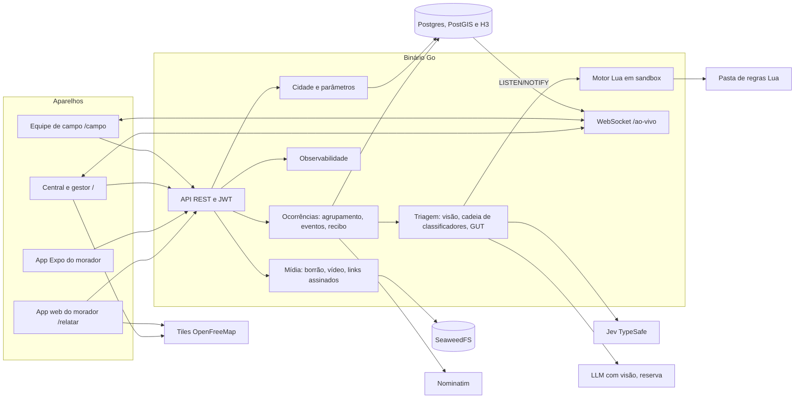
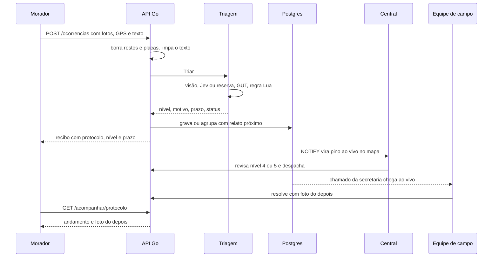
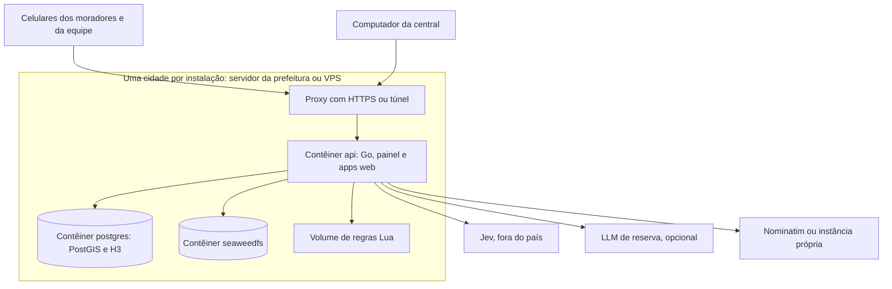

# Arquitetura

Como o MOGI está montado em 15/11/2026, conferido no código. As decisões estão em [adr/](adr/); a stack de base é o [ADR 0013](adr/0013-stack-do-mvp.md), com as mudanças dos ADRs 0014 a 0022. O fluxo do agente, etapa por etapa, está em [fluxo-do-agente.md](fluxo-do-agente.md).

## Em uma tabela
| Parte | Tecnologia | Onde |
|---|---|---|
| API, tempo real e páginas | Go (um binário), JWT, WebSocket | `backend/cmd/api/main.go` |
| Regras da prefeitura | Lua 5.1 pelo gopher-lua, em sandbox de 50 ms | `backend/internal/triagem/lua.go`, `backend/regras/itamogi/` |
| Triagem | Jev (TypeSafe) na frente, LLM com visão de reserva, classificador local por último | `backend/internal/triagem/` |
| Banco | Postgres 16 com PostGIS e H3; migrações embutidas no binário | `infra/`, `backend/internal/banco/migracoes/` |
| Mídia | SeaweedFS (API S3), só acessível pelo Go, com link assinado | `backend/internal/midia/` |
| Tempo real | `LISTEN/NOTIFY` do Postgres repassado por WebSocket, filtrado por secretaria para a equipe de campo | `backend/internal/temporeal/` |
| Endereço | Nominatim com cache no banco | `backend/internal/geo/` |
| Cidade e parâmetros | tabelas `cidades` e `parametros`, editáveis no painel | `backend/internal/cidade/` |
| Observabilidade | métricas em memória, aba Operação, telemetria dos aparelhos | `backend/internal/observa/` |
| Painel | React 19, Vite e MapLibre GL; três páginas: central e gestor (`/`), morador (`/relatar`) e equipe de campo (`/campo`) | `painel/` |
| App nativo | Expo (React Native) com `react-native-maps`, usando a lógica do web | `app/` |
| Implantação | Docker Compose: `postgres`, `seaweedfs`, `api` e `tunel` (Cloudflare Quick Tunnel, só com `make tunel`) | `docker-compose.yml`, `Makefile` |
| Verificação | testes Go, Vitest no painel, jest-expo no app, fumaça e conferência contra o sistema de pé, CI no GitHub Actions | `.github/workflows/ci.yml`, `scripts/` |

O painel e o app web são servidos pelo próprio Go no mesmo endereço; as rotas da API valem na raiz e em `/api`. A única peça fechada é o Jev; o LLM de reserva é opcional. Tudo o mais é open source ([ADR 0012](adr/0012-preferencia-por-open-source-no-mvp.md)).

## Componentes

## Módulos do backend
Monólito modular com portas e adaptadores ([ADR 0002](adr/0002-arquitetura-modular.md), hoje em Go e não em TypeScript). Cada pacote em `backend/internal/`:

| Pacote | Responsabilidade | Portas principais |
|---|---|---|
| `ocorrencias` | envio, recibo, agrupamento, transições, acompanhar, perto, também vi, indicadores | `Repositorio`, `Reavaliador` |
| `triagem` | visão, classificação em cadeia, GUT, regra Lua, prazo | `Descritor`, `Classificador`, `MotorLua` |
| `midia` | borrão seletivo, inspeção de vídeo, armazenamento S3, links assinados | `Borrador`, `Armazenamento`, `Assinador` |
| `auth` | login, papéis (`gestor`, `operador`, `campo`), usuários | |
| `cidade` | cadastro da cidade e parâmetros com cache de 15 s | |
| `observa` | métricas, `/operacao`, `/telemetria`, `/relatorio.csv` | |
| `temporeal` | hub do WebSocket alimentado por `LISTEN/NOTIFY` | |
| `geo` | geocodificação reversa com cache | `Geocodificador` |
| `admin` | regras Lua (simular e salvar com histórico) e categorias | |
| `httpx`, `imagem`, `texto`, `banco`, `config`, `demo` | apoio | |

## Regras em Lua
As regras de prioridade ficam fora do código Go, em `backend/regras/<cidade>/`: `_comum.lua` (faixas da GUT e limiares) e um arquivo por categoria. O motor (`triagem/lua.go`) lê os arquivos a cada triagem, roda num estado Lua novo, só com `base`, `table`, `string` e `math`, e corta em 50 ms. O gestor edita pelo painel; o `admin` simula 13 cenários antes de salvar e grava cada versão em `regras_historico`. Para uma cidade nova, basta outra pasta. Explicação e trecho comentado em [fluxo-do-agente.md](fluxo-do-agente.md#a-regra-da-prefeitura-em-lua).

## Fluxo principal

## Dados
Tabelas principais (migrações `0001` a `0007`): `ocorrencias` (o chamado, com nível, status, triagem e cidade), `relatos` (cada envio, com a chave de idempotência), `midias` (foto, quadro, vídeo e depois, com data de apagar), `triagem_etapas` (custo e latência por etapa), `eventos` (histórico de cada ação), `categorias`, `usuarios`, `regras_historico`, `telemetria`, `geocache`, `cidades`, `parametros` e `parametros_historico`. O local é `geography` do PostGIS e o quadrante é H3 resolução 9.

## Implantação

- **Uma cidade por instalação** ([ADR 0021](adr/0021-cidade-como-dado-e-escala.md)): cada prefeitura tem o seu contêiner, o seu banco e a sua mídia. Mesma imagem no servidor da prefeitura ou numa VPS; a diferença está só no `.env` ([ADR 0018](adr/0018-modulos-e-parametros-em-tempo-de-execucao.md)).
- **Para teste:** `make subir` no notebook e `make tunel` para um link https temporário. **Em servidor próprio:** um proxy com certificado na frente da porta 8080 ([SOP 07](sops/07-deploy-mvp.md)).
- **O que sai da instalação:** só a foto borrada, o texto sem dados pessoais e o bairro, para o Jev (e para o LLM de reserva, se ligado); as coordenadas vão ao Nominatim para achar o endereço (pode ser instância própria).
- **Tamanho do servidor:** uma VPS pequena (2 vCPU e 4 GB) é a estimativa, a confirmar no piloto.

## O que ainda não existe
Fila de triagem fora da requisição, multi-cidade na mesma base, limites compartilhados entre réplicas, métricas no formato do Prometheus, borrão de vídeo, RAG de prazos (RF13) e function calling (RF14). Cada um tem gatilho no [ADR 0021](adr/0021-cidade-como-dado-e-escala.md) ou na [SPEC](spec-mvp.md#situação-dos-requisitos-em-15112026).
