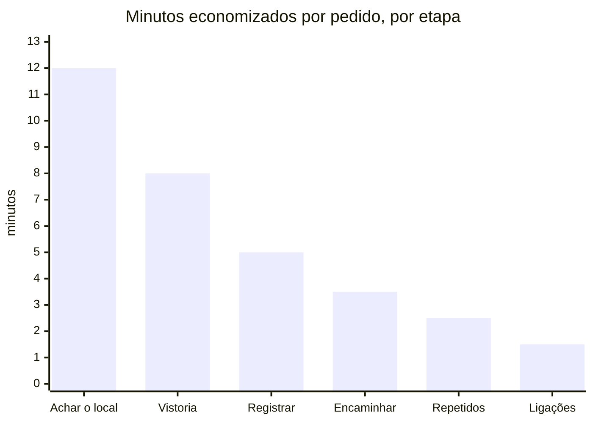

# Quanto tempo a prefeitura economiza com o MOGI

Estimativa do tempo e do dinheiro que o MOGI devolve à prefeitura, por etapa do atendimento, em três tamanhos de demanda. Compara com o fluxo legado descrito em [MOGI frente ao legado](legado-vs-mogi.md).

> **Todas as entradas são hipóteses**, escolhidas de forma conservadora e marcadas assim. Elas viram números reais na visita a Itamogi (veja "Como medir" no fim). As contas estão no fim da página para qualquer pessoa refazer com os dados da prefeitura.

## Resultado em uma linha
Com 400 pedidos por mês, a estimativa é de **cerca de 230 horas de servidor por mês devolvidas**, o equivalente a **1,4 pessoa em tempo integral**, ou **perto de R$ 5,8 mil por mês** em horas de trabalho, frente a um custo de infraestrutura de piloto de cerca de R$ 363 por mês.

## As premissas (hipóteses)

Minutos de servidor por pedido, em cada etapa. "Frequência" é a parte dos pedidos em que a etapa acontece.

| Etapa | Legado: frequência × minutos | MOGI: frequência × minutos | Por que muda |
|---|---|---|---|
| Registrar o pedido e conferir | 100% × 6 min = **6,0** | 100% × 1 min = **1,0** | o morador registra sozinho; a central só confere em um toque |
| Decidir a urgência e encaminhar | 100% × 4 min = **4,0** | 100% × 0,5 min = **0,5** | a IA e a regra da cidade sugerem urgência, prazo e secretaria |
| Equipe achar o local na rua | 100% × 15 min = **15,0** | 100% × 3 min = **3,0** | ponto do GPS no mapa, rota e foto do problema |
| Vistoria só para avaliar antes do serviço | 30% × 40 min = **12,0** | 10% × 40 min = **4,0** | a foto e o vídeo mostram o tamanho do problema antes de sair |
| Pedido repetido (registrar e encaminhar de novo) | 25% × 10 min = **2,5** | 0% = **0,0** | relatos a até 50 m se juntam sozinhos e só sobem a urgência |
| Morador ligando para saber do andamento | 40% × 5 min = **2,0** | 10% × 5 min = **0,5** | o morador acompanha pelo protocolo |
| **Total por pedido** | **41,5 min** | **9,0 min** | **32,5 min a menos por pedido** |

Fixos por mês: relatório para o prefeito e a câmara, **16 h** no legado (juntar planilhas e mensagens) contra **1 h** no MOGI (indicadores prontos e CSV). Hora de servidor com encargos: **R$ 25** (hipótese). Mês de trabalho: **160 h**.

## Três tamanhos de demanda

| Pedidos por mês | Horas no legado | Horas no MOGI | **Horas economizadas** | Pessoas em tempo integral | **Valor em horas (R$/mês)** |
|---:|---:|---:|---:|---:|---:|
| 150 | 119,8 | 23,5 | **96,2** | 0,6 | **R$ 2.406** |
| 400 | 292,7 | 61,0 | **231,7** | 1,4 | **R$ 5.792** |
| 800 | 569,3 | 121,0 | **448,3** | 2,8 | **R$ 11.208** |

```mermaid
xychart-beta
  title "Horas de servidor por mês: legado contra MOGI"
  x-axis ["150 pedidos", "400 pedidos", "800 pedidos"]
  y-axis "horas por mês" 0 --> 600
  bar [119.8, 292.7, 569.3]
  bar [23.5, 61.0, 121.0]
```

A primeira barra de cada grupo é o legado; a segunda, o MOGI.

**Onde está a economia** (minutos por pedido economizados, por etapa):

Quase dois terços da economia está **na rua**: a equipe chega ao ponto certo e já sabe o que vai encontrar. É tempo de caminhão, combustível e equipe, não só de mesa.

## Outros ângulos

| Ângulo | Estimativa ou efeito | Base |
|---|---|---|
| **Tempo do morador** | com 400 pedidos, **cerca de 57 horas por mês** a menos de ligação e espera (10 min contra 1,5 min por pedido) | hipótese |
| **Ponto de equilíbrio** | mesmo sem contar o relatório, **cerca de 27 pedidos por mês** já pagam a infraestrutura do piloto (R$ 363 ÷ R$ 13,54 economizados por pedido) | conta |
| **Cenário pessimista** | se a economia real for só metade da estimada, 400 pedidos ainda devolvem cerca de 116 horas e R$ 2,9 mil por mês | conta |
| **Urgência certa primeiro** | o cano estourado perto da escola sai na frente do lixo parado, em vez de esperar a ordem de chegada; o prazo do nível 5 é de 2 horas | regra da cidade |
| **Menos retrabalho** | sem pedido duplicado, sem vistoria à toa, sem endereço errado | premissas acima |
| **Combustível e veículo** | menos idas só para olhar (de 30% para 10% dos pedidos, na hipótese) | hipótese |
| **Transparência** | protocolo, prazo e foto do depois para o morador; trilha de quem fez o quê para a ouvidoria e o controle interno | sistema |
| **Decisão do gestor** | indicadores ao vivo por bairro, categoria e prazo, em vez de relatório do mês passado | sistema |
| **Escala regional** | a mesma economia por pedido vale em cada cidade que entrar; o custo de mais uma cidade é uma linha no banco e uma pasta de regras | [ADR 0021](adr/0021-cidade-como-dado-e-escala.md) |

O tempo economizado **não vira demissão**: volta para a rua, para o atendimento presencial de quem não usa celular e para o serviço que estava parado.

## Como medir na visita (para trocar hipótese por dado)
1. Quantos pedidos de zeladoria a prefeitura recebe por mês, e por qual canal (telefone, WhatsApp, balcão, ouvidoria).
2. Cronometrar 10 atendimentos: registrar, decidir e encaminhar.
3. Perguntar à equipe: quanto tempo leva para achar o local e com que frequência vai só para olhar antes do serviço.
4. Quantos pedidos são repetidos do mesmo problema e quantas ligações de "e aí?" chegam por semana.
5. Quanto tempo leva o relatório mensal.
6. No teste de campo, comparar com o que o MOGI mede sozinho: tempo até conferir, até despachar e até resolver.

## As contas
Minutos por pedido = soma de frequência × minutos de cada etapa: legado 41,5; MOGI 9,0.

Horas por mês = (pedidos × minutos por pedido + minutos do relatório) ÷ 60. Exemplo com 400 pedidos: legado (400 × 41,5 + 960) ÷ 60 = 292,7 h; MOGI (400 × 9,0 + 60) ÷ 60 = 61,0 h; economia 231,7 h.

Pessoas em tempo integral = horas economizadas ÷ 160. Valor = horas economizadas × R$ 25.

Para refazer com os dados de Itamogi, troque os minutos, as frequências, o volume e o valor da hora: a fórmula é a mesma.
