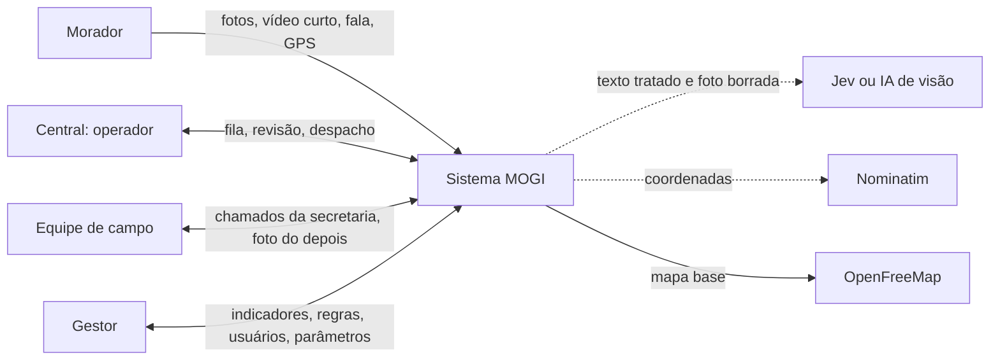
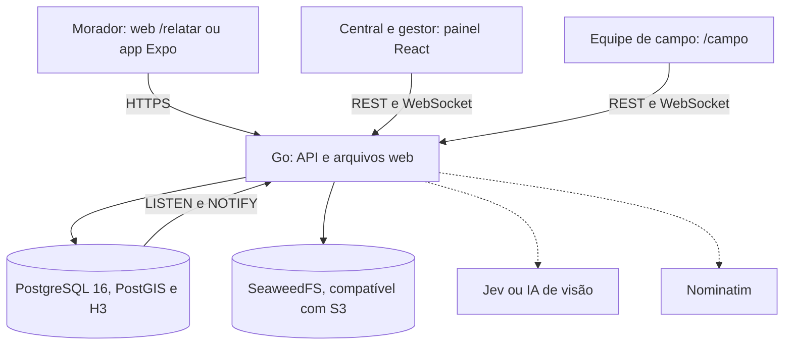
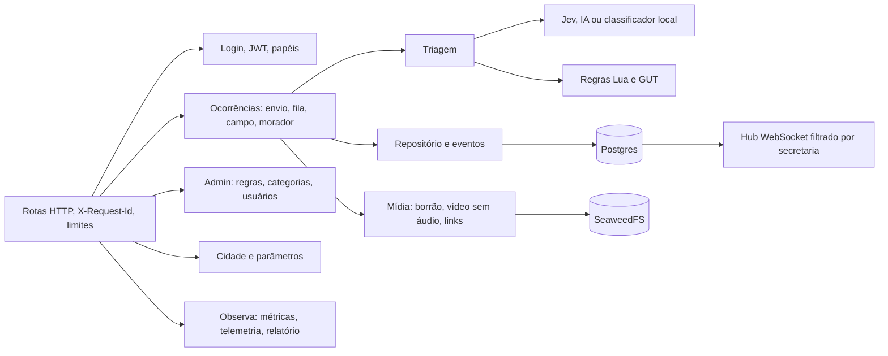
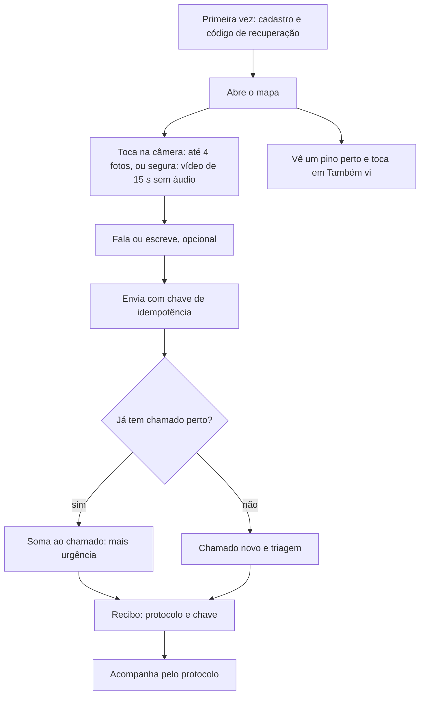
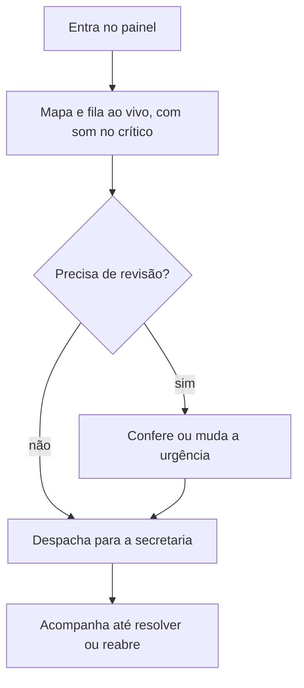
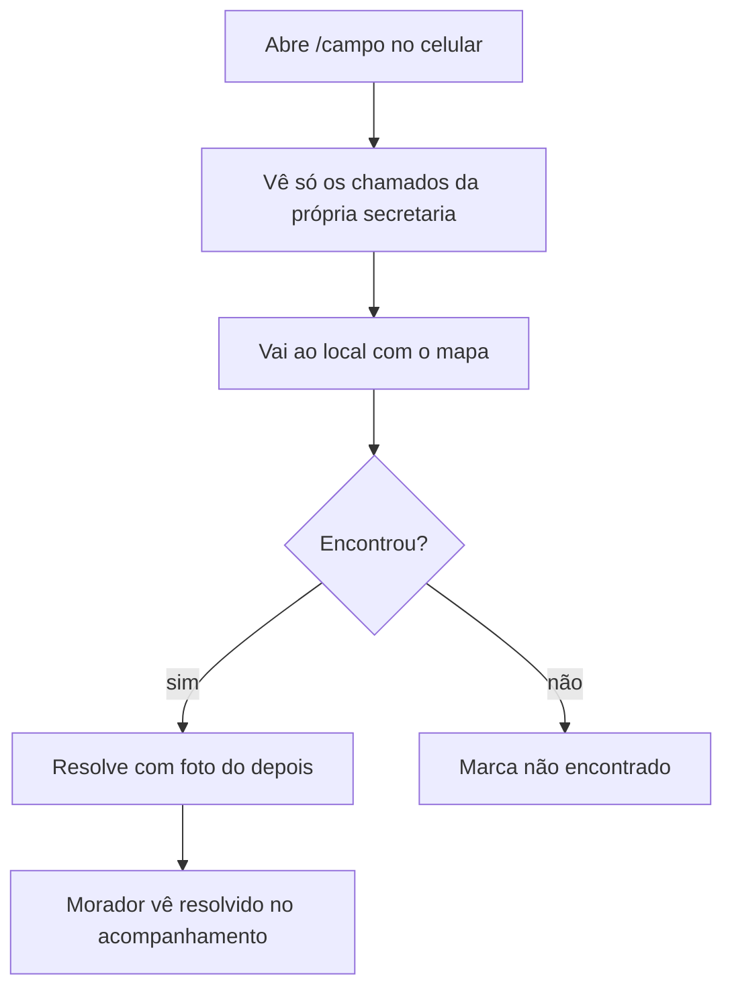
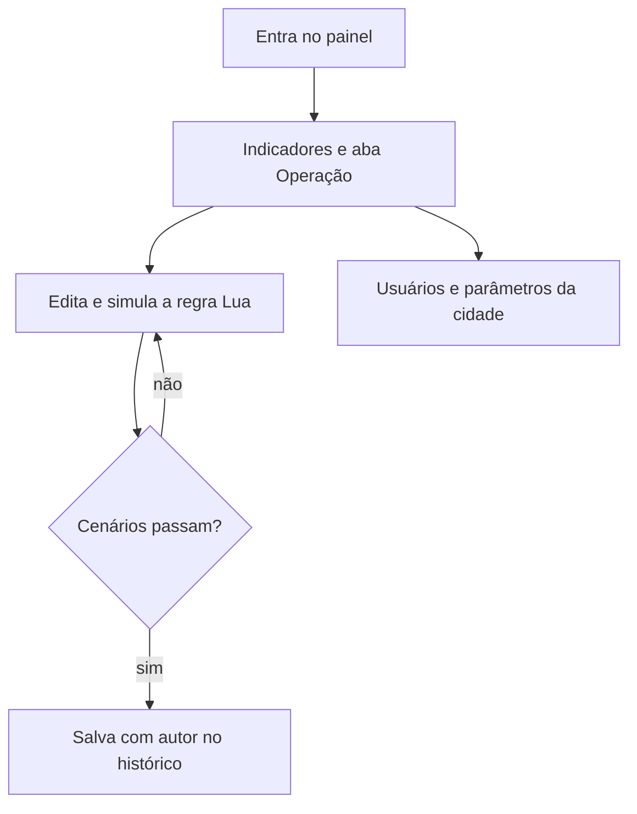

# Arquitetura e fluxos

Visões C4 em Mermaid, com nomes que existem no repositório. Linha pontilhada é integração opcional.

## Contexto

## Contêineres

O Compose sobe Postgres, SeaweedFS e a API (perfil `app`), mais o túnel opcional para o teste no celular (`make tunel`). O Go recebe as mídias, borra, guarda e entrega por link assinado; não há upload direto ao armazenamento.

## Componentes da API

## Jornadas por usuário

**Morador** (cadastro com CPF ou CNPJ feito uma vez, ADR 0024; o envio continua repetível, ADR 0020):

**Operador da central:**

**Equipe de campo** (papel `campo`, ADR 0016):

**Gestor:**

A simulação confere que a regra roda e bate com os cenários; não substitui a aprovação da política pública. **Ainda não implementado:** notificação ativa ao morador, pergunta automática e despacho automático citados no [fluxo do agente](../fluxo-do-agente.md) como próximos passos.
