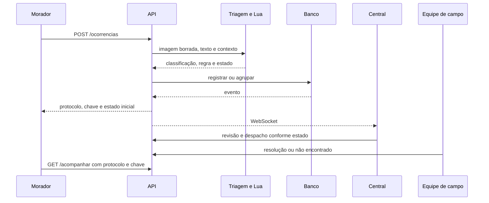

# Casos de uso e rotas da API

Fonte de autoridade: [registro de rotas](../../backend/cmd/api/main.go), [handlers](../../backend/internal/ocorrencias/handlers.go) e [rotas do morador](../../backend/internal/ocorrencias/morador.go). Todas as rotas abaixo também existem com prefixo `/api`. JWT exige usuário ativo; `central` significa `operador` ou `gestor`. O papel `campo` acessa ocorrências da própria secretaria.

| Caso de uso | Método e rota | Acesso e resultado |
|---|---|---|
| Verificar saúde | `GET /saude` | Aberto, consulta banco e disponibilidade do bucket de mídia; 503 se algum falhar |
| Preparar captura | `GET /config` | Aberto, cidade, centro, módulos, limites, disponibilidade de visão e categorias |
| Consultar categorias do Expo | `GET /categorias` | Aberto |
| Autenticar central ou gestor | `POST /auth/login` | Aberto, emite JWT após autenticação |
| Identificar sessão | `GET /auth/eu` | JWT |
| Morador enviar relato | `POST /ocorrencias` | Aberto, multipart com uma a quatro fotos, latitude e longitude; vídeo opcional sem áudio, texto e categoria opcionais. `Idempotency-Key` evita repetir envio; `X-Mogi-Aparelho` auxilia limite |
| Morador acompanhar | `GET /acompanhar/{protocolo}?k=...` | Aberto com chave secreta do recibo; não basta conhecer o protocolo |
| Morador ver relatos próximos | `GET /perto` | Aberto, com coordenadas e módulo habilitado; resultado limitado e aproximado |
| Morador confirmar problema próximo | `POST /perto/confirmacao` | Aberto, condicionado à localização e ao módulo; uma confirmação por aparelho e chamado |
| Central ou campo consultar fila e detalhe | `GET /ocorrencias`, `GET /ocorrencias/{id}` | JWT; campo limitado à própria secretaria |
| Consultar secretarias | `GET /secretarias` | JWT |
| Central revisar | `POST /ocorrencias/{id}/revisao` | Central; informa nível de 1 a 5 |
| Central despachar | `POST /ocorrencias/{id}/despacho` | Central; secretaria e observação opcionais |
| Registrar resolução | `POST /ocorrencias/{id}/resolucao` | JWT; campo somente da própria secretaria. Texto e até três fotos do depois são opcionais |
| Informar não encontrado | `POST /ocorrencias/{id}/nao-encontrado` | JWT, com motivo; campo somente da própria secretaria |
| Central reabrir | `POST /ocorrencias/{id}/reabertura` | Central, com motivo |
| Abrir vídeo original | `POST /ocorrencias/{id}/midias/{midia}/abertura` | JWT, com restrição de secretaria para campo; registra abertura e retorna link de 10 minutos |
| Acompanhar indicadores | `GET /indicadores` | Central; aceita `dias` e `reais=1` |
| Acompanhar operação | `GET /operacao`, `GET /relatorio.csv` | Gestor; métricas, saúde e relatório |
| Informar falha do aparelho | `POST /telemetria` | Aberto, sujeito a limite por IP |
| Gestor consultar regras | `GET /admin/regras` | JWT de gestor |
| Gestor simular regra | `POST /admin/regras/testar` | JWT de gestor; não salva |
| Gestor salvar regra | `PUT /admin/regras/{arquivo}` | JWT de gestor; valida cenários e registra histórico |
| Gestor consultar categorias | `GET /admin/categorias` | JWT de gestor |
| Gestor alterar categoria | `PUT /admin/categorias/{id}` | JWT de gestor |
| Gestor administrar usuários | `GET /admin/usuarios`, `POST /admin/usuarios`, `PUT /admin/usuarios/{login}` | JWT de gestor |
| Gestor ajustar parâmetros | `GET /admin/parametros`, `PUT /admin/parametros` | JWT de gestor |
| Exibir mídia | `GET /midia` | Link assinado temporário sem JWT no pedido; foto borrada ou vídeo restrito previamente autorizado |
| Atualizar painel | `GET /ao-vivo?token=...` | WebSocket com token e checagem de origem; campo recebe eventos da própria secretaria |

O limite usa identificador fornecido pelo cliente e IP, com padrões de 12 e 120 envios em 10 minutos, configuráveis. Cabeçalhos de proxy só são considerados se `PROXY_CONFIAVEL=true`. Em múltiplas réplicas os limites são independentes. A cadeia de classificação segue Jev, IA opcional e classificador local; falha de regra ou de todos os classificadores resulta em `a_classificar`. Foto borrada pode ser enviada ao Jev quando `JEV_FOTO=true`; filtro de texto não prova anonimização completa.
