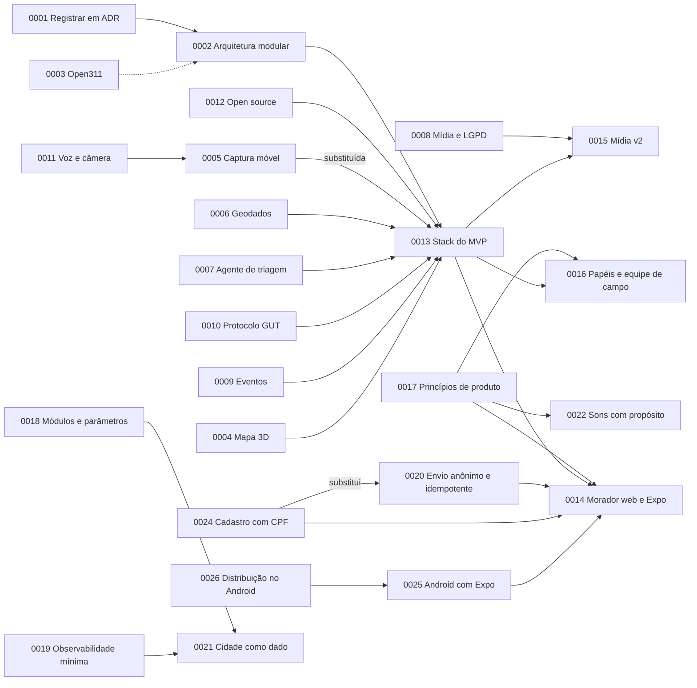

# Mapa das ADRs

São 22 decisões em [docs/adr](../adr/). As de 0014 a 0022 nasceram na preparação do teste de campo (14 e 15/11) e estão como **Proposta** até a validação em Itamogi.

| ADR | O que decide |
|---|---|
| [0001](../adr/0001-registrar-decisoes-em-adr.md) a [0004](../adr/0004-mapa-3d-e-tempo-real.md) | Registrar decisões, módulos, padrão Open311, mapa 3D ao vivo |
| [0005](../adr/0005-captura-movel.md), [0011](../adr/0011-captura-por-voz-e-camera.md) | Captura no celular com câmera e voz; a escolha de tecnologia foi substituída pela 0013 |
| [0006](../adr/0006-geodados.md) | PostGIS e H3 |
| [0007](../adr/0007-agente-de-triagem.md), [0010](../adr/0010-protocolo-de-triagem-urbana.md) | Cadeia de classificadores e regra GUT em Lua |
| [0008](../adr/0008-midia-e-privacidade-lgpd.md) | Borrão e retenção de 90 dias; implementada na 0015 |
| [0009](../adr/0009-tempo-real-por-eventos.md) | LISTEN/NOTIFY e WebSocket |
| [0012](../adr/0012-preferencia-por-open-source-no-mvp.md), [0013](../adr/0013-stack-do-mvp.md) | Open source primeiro; Go, Postgres, SeaweedFS, React, Expo, Lua |
| [0014](../adr/0014-app-do-morador-web-e-expo.md) | App do morador na web (referência) e no Expo (paridade) |
| [0015](../adr/0015-midia-v2-varias-fotos-e-video.md) | Até 4 fotos, vídeo de 15 s sem áudio, link restrito auditado, retenção |
| [0016](../adr/0016-ciclo-de-vida-papeis-e-equipe-de-campo.md) | Ciclo de vida, papéis e equipe de campo por secretaria |
| [0017](../adr/0017-principios-de-produto.md) | Funcionalidade na frente, uma ação só, simplicidade para quem opera |
| [0018](../adr/0018-modulos-e-parametros-em-tempo-de-execucao.md) | Módulos e limites mudam sem deploy, na prefeitura ou na nuvem |
| [0019](../adr/0019-observabilidade-minima.md) | Métricas, telemetria e relatório sem serviço extra |
| [0020](../adr/0020-envio-anonimo-e-idempotente.md) | Envio repetível, com limite por aparelho; o "sem login" foi substituído pela 0024 |
| [0021](../adr/0021-cidade-como-dado-e-escala.md) | Cidade como linha no banco e gatilhos para escalar |
| [0022](../adr/0022-sons-com-proposito.md) | Cada som com um propósito, sempre junto de um sinal visual |
| [0024](../adr/0024-cadastro-do-morador-com-cpf.md) | Cadastro do morador com CPF ou CNPJ cifrado, mascarado e com acesso auditado; Meu bairro; filtro de espaço público |
| [0025](../adr/0025-android-com-expo-e-desenvolvimento-agentico.md) | Android no Expo com TypeScript, projeto nativo gerado, Kotlin só como módulo; por que serve ao desenvolvimento agêntico |
| [0026](../adr/0026-distribuicao-no-android.md) | Distribuição em três degraus: app web instalado, APK de teste do CI, Play Store no piloto |
