# Modelo de dados e LGPD

Fontes: [migrações 0001 a 0007](../../backend/internal/banco/migracoes/) e [banco.go](../../backend/internal/banco/banco.go). O diagrama mostra relações efetivamente declaradas; `revisado_por`, `despachado_por`, `resolvido_por` e `autor` são texto, sem chave estrangeira para `usuarios`. Categoria e secretaria também são texto, sem FK.

```mermaid
erDiagram
  ocorrencias ||--o{ relatos : contem
  ocorrencias ||--o{ triagem_etapas : registra
  ocorrencias ||--o{ eventos : registra
  ocorrencias ||--o{ midias : possui
  relatos o|--o{ midias : origina
  cidades ||--o{ ocorrencias : identifica
  cidades ||--o{ usuarios : identifica
  cidades ||--o| parametros : configura
  cidades ||--o{ parametros_historico : historico
  ocorrencias {
    uuid id PK
    text protocolo UK
    text categoria
    geography local
    text midia_original
    text midia_publica
    text status
    smallint nivel
    jsonb triagem
    integer relatos
    text secretaria
    boolean demo
    text cidade FK
  }
  relatos {
    uuid id PK
    uuid ocorrencia_id FK
    text texto
    geography local
    text midia_original
    text midia_publica
    uuid id_cliente UK
    text chave
    text aparelho
    text tipo
  }
  triagem_etapas {
    bigint id PK
    uuid ocorrencia_id FK
    text etapa
    numeric custo_brl
    integer ms
    text erro
  }
  usuarios {
    bigint id PK
    text login UK
    text senha_hash
    text papel
    text cidade FK
    text nome
    text secretaria
    boolean ativo
  }
  midias {
    uuid id PK
    uuid ocorrencia_id FK
    uuid relato_id FK
    text tipo
    text chave_original
    text chave_publica
    timestamptz apagar_em
    timestamptz apagada_em
  }
  eventos {
    bigint id PK
    uuid ocorrencia_id FK
    text tipo
    text autor
    jsonb dados
  }
  categorias {
    text id PK
    text nome
    text secretaria
  }
  geocache {
    text chave PK
    text endereco
    text bairro
  }
  regras_historico {
    bigint id PK
    text cidade
    text arquivo
    text conteudo
    text autor
  }
  telemetria {
    bigint id PK
    text tipo
    text detalhe
    text tela
    text navegador
  }
  cidades {
    text slug PK
    text nome
    text caixa
  }
  parametros {
    text cidade PK,FK
    jsonb valor
    text atualizado_por
  }
  parametros_historico {
    bigint id PK
    text cidade FK
    jsonb valor
    text autor
  }
  migracoes {
    text nome PK
    timestamptz aplicada_em
  }
```

`migracoes` é criada pelo código de inicialização, não pelos dois arquivos SQL. Há sequência `protocolo_seq`, índices espaciais e de fila, trigger de atualização e NOTIFY. H3 é opcional na migração e `h3_r9` pode ser nulo.

| Dados ou campo | Tratamento de privacidade |
|---|---|
| `usuarios.login`, `nome`, `senha_hash`, papel, secretaria e horários | Dados vinculáveis a servidor; hash é credencial sensível, não senha em claro |
| `ocorrencias` e `relatos`: texto, ponto exato, precisão, endereço, bairro, horários e protocolo | Potencialmente pessoais ou identificáveis por combinação; texto livre pode conter identificadores ou dados sensíveis |
| `midias`, `midia_original` e `midia_publica` | Chaves para objetos; imagens podem identificar pessoas, mesmo borradas. Foto original e cópia ficam no armazenamento S3 compatível; vídeo original não é borrado |
| `moradores` e `relatos.morador_id` | Nome, tipo, profissão, bairro e CPF ou CNPJ de quem relata: dado pessoal direto. Documento cifrado, achado por HMAC e mostrado mascarado; completo só para o gestor, com registro; apagado com a conta (ADR 0024) |
| `relatos.chave`, `id_cliente`, `aparelho` | Segredo de acompanhamento e identificadores pseudônimos, potencialmente vinculáveis; proteger contra acesso indevido |
| `triagem` e `triagem_etapas.erro` | Podem conter contexto, descrições ou mensagens identificáveis; custos e tempos associados à ocorrência também podem ser vinculáveis |
| `eventos.autor`, `eventos.dados`, `revisado_por`, `despachado_por`, `resolvido_por`, autores de regras e parâmetros | Podem identificar agentes públicos e conter informações de contexto |
| `geocache.chave`, endereço e bairro | Localização aproximada e contexto, potencialmente identificáveis por associação |
| `telemetria.detalhe`, `tela`, `navegador` | Código filtra padrões pessoais e não persiste IP nem ID de aparelho, mas detalhes e combinações ainda exigem revisão |
| `categorias`, `cidades`, `parametros`, `migracoes`, regra e metadados técnicos | Em geral operacionais, mas conteúdo livre e histórico exigem revisão contextual |

Desde o ADR 0024, a tabela `moradores` guarda nome, tipo, profissão e bairro do morador que relata, com o CPF ou CNPJ cifrado (AES-256-GCM), um HMAC para achar o cadastro e só a versão mascarada em claro; `relatos.morador_id` liga o relato a ela e vira nulo quando o morador apaga a conta. O documento completo só abre para o gestor, com evento `documento_visto` no histórico do chamado. Consulte o [pacote morador](../../backend/internal/morador/). A API entrega fotos borradas por link assinado. O vídeo original, sem borrão, pode ser aberto por servidor autorizado mediante link de 10 minutos, com registro do acesso. A filtragem do texto antes da gravação e triagem não remove necessariamente nomes ou todo dado pessoal, e o borrão seletivo tem limitações documentadas no README. O Nominatim configurado recebe coordenadas; serviços externos de IA podem receber foto borrada e contexto conforme configuração. Consulte [handlers](../../backend/internal/ocorrencias/handlers.go) e [triagem](../../backend/internal/triagem/servico.go).

A retenção implementada programa o apagamento de foto original e vídeo a partir do envio, por padrão em 90 dias, ajustáveis por cidade; `0` desliga o agendamento para novas mídias. A data é gravada no cadastro da mídia no envio, não recalculada automaticamente para mídias existentes ao mudar o parâmetro. A rotina roda na partida e de hora em hora, depende do processo e armazenamento disponíveis, e mantém as versões borradas. A telemetria tem limpeza própria de 30 dias. Veja [ADR 0015](../adr/0015-midia-v2-varias-fotos-e-video.md), [main.go](../../backend/cmd/api/main.go) e [parâmetros](../../backend/internal/cidade/cidade.go). A rotina não comprova exclusão em backups ou cópias externas.

**Proposta para implantação:** inventário e base legal com a prefeitura, análise de riscos e contratos com operadores, segregação de acesso, prazo de retenção aprovado, política para derivados e backups, e teste de restauração e exclusão. Não afirmar conformidade LGPD sem avaliação específica.
