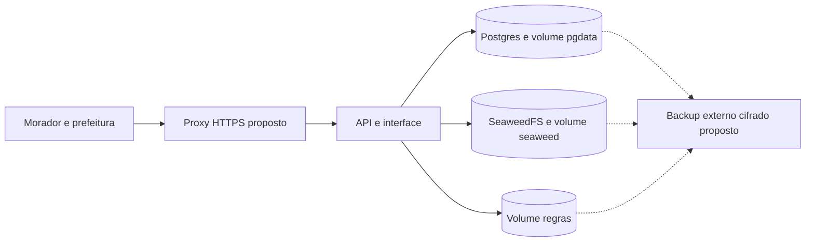

# Implantação e operação em prefeitura

**Proposta, não implantação comprovada.** O Compose atual é uma base de piloto em servidor único, não um pacote de produção completo. A [SOP 07](../sops/07-deploy-mvp.md) sugere VPS Linux com 2 vCPU e 4 GB, a confirmar, e Caddy; o Compose do repositório não contém Caddy. A imagem do projeto serve a interface compilada junto da API. O acesso móvel a câmera e GPS exige HTTPS.

| Opção proposta | Aplicação | Limites e decisões |
|---|---|---|
| Servidor local da prefeitura | Compose em máquina sob gestão municipal, proxy HTTPS e acesso externo controlado | Energia, internet, disco, segurança física e equipe local são responsabilidade da prefeitura. Dados externos de IA e geocodificação continuam saindo se configurados |
| VPS | Mesmo desenho em servidor contratado, com firewall e domínio | Mais simples que serviços gerenciados, mas atualização, restauração e disponibilidade continuam sob responsabilidade operacional |
| Nuvem | Máquina virtual equivalente ou serviços gerenciados | Requer revisão de arquitetura, custos, dados e contratos. A [proposta AWS](07-aws.md) detalha mudanças |

## Colocação em serviço

1. **Proposta:** definir responsável técnico, encarregado de dados, titularidade e acesso, domínio, rede, inventário, capacidade, manutenção e suporte com a prefeitura.
2. Provisionar Docker e Compose; manter banco e S3 fora da rede pública. Configurar proxy HTTPS com WebSocket, firewall, origem do WebSocket e política de confiança dos cabeçalhos. O proxy e as regras de rede exigem configuração adicional.
3. Criar `.env` fora do Git com segredos fortes; configurar usuários iniciais de gestor, operador e campo, `DEMO_CHAMADOS=0`, `CIDADE`, nome, centro, cerca, provedor, geocodificação e borrador. Configurar a pasta de regras da cidade, secretarias e parâmetros. Cada município deve ter sua própria instalação, banco e mídia: a coluna `cidade` não garante isolamento multitenant. Algumas categorias e o texto de contexto enviado aos modelos continuam fixos, conforme [ADR 0021](../adr/0021-cidade-como-dado-e-escala.md).
4. Construir e iniciar os serviços conforme [README](../../README.md). O banco aplica migrações embutidas na inicialização; planejar manutenção e rollback antes de atualizações.
5. Antes de abrir ao público, validar o borrão com fotos reais autorizadas, acessibilidade, limites de abuso, revisão humana, termos, retenção e fluxo completo no celular. A SOP não comprova prontidão para produção.

## Backup, restauração e suporte

**Proposta:** fazer backup diário de `pgdata` por backup consistente do Postgres, dos objetos do SeaweedFS e do volume `regras`, com cópia cifrada fora da máquina, controle de acesso e política de retenção aprovada. Banco, objetos e regras precisam ser recuperáveis de um ponto consistente; cópia de volume em uso sem procedimento apropriado não é garantia de consistência. Incluir configuração necessária sem expor segredos e manter segredos em cofre separado.

**Proposta:** testar periodicamente restauração em ambiente isolado, validar registros, objetos e regras, medir perda máxima de dados e tempo de recuperação, e registrar resultados. RPO e RTO devem ser negociados, não são valores comprovados. A migração atual registra referências a objetos, não faz backup deles.

O endpoint `/saude` já verifica banco e bucket; a aba Operação mostra filas, erros, latências e telemetria. A rotina de retenção apaga originais vencidas enquanto a API está em execução, normalmente 90 dias após o envio, com prazo ajustável; não limpa automaticamente backups. **Proposta:** acompanhar também espaço em disco e certificados, definir plantão, contato da prefeitura, janela de atualização, responsável por incidentes, escalonamento do fornecedor de IA e procedimento manual quando sistema ou internet caírem. Não há SLA de suporte declarado no repositório.
