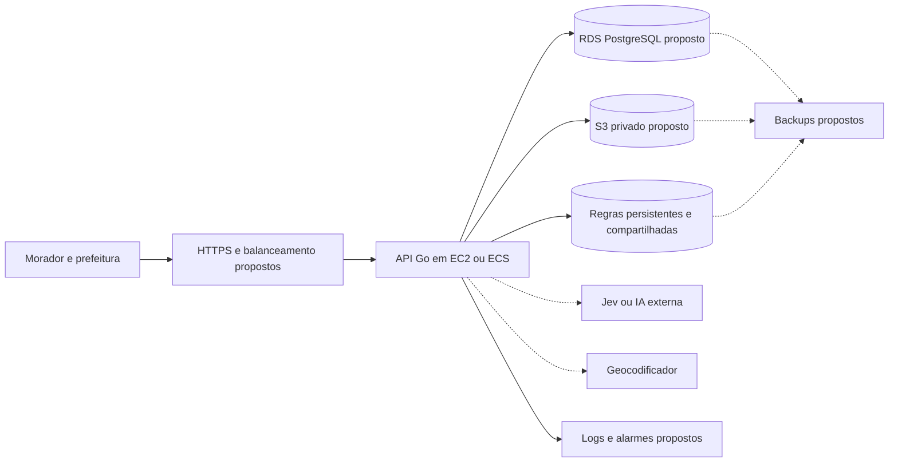
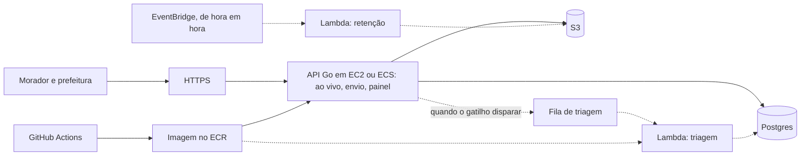

# AWS em São Paulo: proposta

**Proposta, custos a confirmar.** Região pretendida `sa-east-1`. O projeto não comprova implantação AWS, alta disponibilidade, isolamento multitenant em uma base ou custos contratados. Confirme disponibilidade e versões de cada serviço e extensão, arquitetura, tributos, câmbio e cotação com a [calculadora AWS](https://calculator.aws/) antes de contratação.

| Peça atual | Mapeamento proposto | Mudanças ou verificações |
|---|---|---|
| Go e web estática | EC2 com Compose; alternativamente ECS | EC2 pode preservar o desenho de servidor único; ECS exige imagem, rede, armazenamento e operação adicionais. Proxy ou balanceador deve suportar WebSocket |
| Postgres, PostGIS e H3 | RDS PostgreSQL | Confirmar versões e suporte a extensões na região e instância escolhidas; H3 é opcional na migração e, se indisponível, há impacto no mapa. Testar migrações, conexões e LISTEN/NOTIFY |
| SeaweedFS | S3 privado | O adaptador existente fixa região `us-east-1` e usa credenciais estáticas; parametrizar região `sa-east-1`, revisar criação de bucket, endpoint, TLS e preferir cadeia de credenciais com papel IAM. Testar leitura, escrita e links assinados pela API |
| Volume de regras | Volume persistente na EC2; alternativa EFS ou repositório transacional | Para várias réplicas, definir consistência de leitura, escrita, backup e concorrência. O histórico no banco não substitui os arquivos |
| Segredos e configuração | Secrets Manager ou outro cofre, IAM | Integrar entrega e rotação de segredos; não colocar `.env` na imagem. Configurar `DATABASE_URL` com TLS adequado, pois a URL montada por padrão usa `sslmode=disable` |
| Proxy e domínio | ALB e certificado ACM, ou proxy em EC2 | Definir TLS, cabeçalhos confiáveis, regras de rede, origens WebSocket e limite de requisições compartilhado |
| Logs, saúde e backup | CloudWatch, snapshots e políticas de backup, conforme arquitetura | A API já oferece `/saude`, métricas locais e logs JSON opcionais; integrar coleta, alarmes e retenção. Ensaiar restauração conjunta de banco, objetos e regras. A rotina de expiração não remove dados em backups |
| Jev, IA, Nominatim e tiles | Continuam externos ou são substituídos por alternativas avaliadas | Região AWS não determina região desses fornecedores; revisar transferência de dados, termos, limites e custos. A API envia coordenadas ao geocodificador configurado |

## Cotação pública de referência

Consulta em **15/11/2026** aos catálogos oficiais da AWS para `sa-east-1`, modalidade sob demanda, sem reserva ou créditos. São preços de lista em dólares, não uma proposta comercial da AWS nem garantia de fatura. Para conversão comparável com `.env.example`, usamos **US$ 1 = R$ 5,50**, câmbio de simulação, não cotação de mercado. Premissas de quantidade são propostas, não carga medida. Instâncias ligadas por 730 horas/mês; preços podem mudar.

Fontes primárias: catálogos regionais [EC2 e EBS](https://pricing.us-east-1.amazonaws.com/offers/v1.0/aws/AmazonEC2/current/sa-east-1/index.csv), [RDS](https://pricing.us-east-1.amazonaws.com/offers/v1.0/aws/AmazonRDS/current/sa-east-1/index.csv), [S3](https://pricing.us-east-1.amazonaws.com/offers/v1.0/aws/AmazonS3/current/sa-east-1/index.csv), [balanceador](https://pricing.us-east-1.amazonaws.com/offers/v1.0/aws/AWSELB/current/sa-east-1/index.csv) e [VPC e IPv4](https://pricing.us-east-1.amazonaws.com/offers/v1.0/aws/AmazonVPC/current/sa-east-1/index.csv). Os catálogos `current` mudam: na consulta as publicações eram, respectivamente, 14/11, 13/11, 09/11, 11/11 e 05/11/2026. A AWS informa que os arquivos são informativos e que a página de preços prevalece em caso de divergência. Para reconferir e ajustar parâmetros, use a [calculadora AWS](https://calculator.aws/).

### Cenário A: piloto em um servidor

**Proposta:** uma EC2 Linux `t3.medium`, 2 vCPU e 4 GiB, com o Compose atual, proxy HTTPS na própria máquina, banco e SeaweedFS no mesmo EBS. Sem RDS, S3 nem ALB. O dimensionamento não foi submetido a teste de carga.

| Componente | Premissa e preço público | US$/mês |
|---|---|---:|
| EC2 `t3.medium` Linux | 730 h × US$ 0,0672/h | 49,056 |
| EBS gp3 | 60 GB provisionados × US$ 0,152/GB-mês | 9,120 |
| IPv4 público | 730 h × US$ 0,005/h | 3,650 |
| Snapshot EBS padrão | 60 GB médios armazenados × US$ 0,068/GB-mês | 4,080 |
| **Subtotal AWS** | Sem os itens não cotados abaixo | **65,906** |

Ao câmbio de simulação, o subtotal é **R$ 362,48/mês**. Snapshot é cobrado pelo volume de dados armazenado, não pelo tamanho provisionado necessariamente. A hipótese de 60 GB não demonstra consistência da cópia ou recuperação dos dados; configurar e testar backup consistente de banco, mídia e regras.

### Cenário B: banco e mídia gerenciados

**Proposta de arquitetura**, não sistema multitenant pronto: uma EC2 Linux `t3.large`, RDS PostgreSQL `db.t3.medium` em uma zona, S3 privado e ALB. Uma instância de API e RDS Single-AZ não oferecem alta disponibilidade. O RDS e S3 exigem as adaptações descritas acima. Verificar compatibilidade de PostGIS e H3, antes de depender desse desenho.

| Componente | Premissa e preço público | US$/mês |
|---|---|---:|
| EC2 `t3.large` Linux | 730 h × US$ 0,1344/h | 98,112 |
| EBS gp3 da EC2 | 40 GB × US$ 0,152/GB-mês | 6,080 |
| Snapshot EBS padrão | 40 GB médios × US$ 0,068/GB-mês | 2,720 |
| RDS PostgreSQL `db.t3.medium` Single-AZ | 730 h × US$ 0,151/h | 110,230 |
| Armazenamento RDS gp3 | 50 GB × US$ 0,219/GB-mês | 10,950 |
| S3 Standard | 100 GB médios × US$ 0,0405/GB-mês, primeira faixa | 4,050 |
| Requisições S3 | 20 mil PUT × US$ 0,007/mil e 100 mil GET × US$ 0,00056/mil | 0,196 |
| ALB | 730 h × US$ 0,034/h | 24,820 |
| Capacidade ALB | Média hipotética de 1 LCU × 730 h × US$ 0,011/LCU-h | 8,030 |
| IPv4 públicos | Hipótese de 3 endereços, um na EC2 e dois no ALB, × 730 h × US$ 0,005/h | 10,950 |
| **Subtotal AWS** | Sem os itens não cotados abaixo | **276,138** |

Ao câmbio de simulação, o subtotal é **R$ 1.518,76/mês**. O uso real de LCU, IPv4, requisições e armazenamento depende da configuração e do tráfego. O cenário pressupõe backup automático RDS dentro da franquia aplicável, sem cópias extras; backup excedente e proteção de objetos S3 não estão precificados. Proteção, isolamento de rede e restauração precisam ser projetados e cotados.

### Por relato e custos fora do subtotal

| Cenário | Relatos/mês, hipótese | Subtotal AWS | IA de teste com foto | Subtotal combinado | Por relato |
|---|---:|---:|---:|---:|---:|
| A | 1.000 | R$ 362,48 | R$ 0,70 | R$ 363,18/mês | R$ 0,3632 |
| B | 20.000 | R$ 1.518,76 | R$ 14,00 | R$ 1.532,76/mês | R$ 0,0766 |

A IA usa apenas a referência histórica do [README](../../README.md), R$ 0,0007 por relato com foto; não é preço AWS nem tarifa garantida. Cálculos foram feitos antes de arredondar. Os dois números por relato são **subtotais**, não custo total.

**Não incluídos ou não dimensionados:** tráfego de saída para internet e entre zonas, NAT Gateway ou endpoints privados se usados, DNS e domínio, logs e alarmes, cofre de segredos, backup RDS excedente, backup e versionamento do S3, restauração, suporte AWS, impostos, câmbio efetivo, operação humana e eventuais cobranças por CPU excedente das instâncias T3. Não se assumem franquias gratuitas para armazenamento, requisições ou tráfego; somente a hipótese de backup RDS acima. Os volumes, retenção, requisições, tráfego e arquitetura devem ser medidos e precificados antes de contratar. A AWS e os fornecedores de IA faturam conforme consumo e condições da conta.

## Lambda: onde cabe e onde não cabe

**Resposta curta:** não para o servidor principal, sim para tarefas em segundo plano quando o volume pedir. É proposta, não implementado.

O servidor do MOGI é um processo Go que fica ligado: mantém o **WebSocket** do painel ao vivo, escuta o **LISTEN/NOTIFY** do Postgres, roda a **retenção de hora em hora** e guarda métricas e limites em memória. Lambda é o oposto: liga por pedido, vive segundos e não segura conexão.

| Peça do MOGI | Em Lambda? | Por quê |
|---|---|---|
| API, painel e app web | **não** | o ao vivo precisa de conexão aberta (WebSocket); em Lambda exigiria API Gateway WebSocket, tabela de conexões e reescrever o hub. Cada pedido abriria conexão com o banco (pede RDS Proxy) e a primeira chamada fria atrasa o recibo do morador |
| Escuta do banco (LISTEN/NOTIFY) | **não** | precisa de uma conexão ligada o tempo todo |
| Retenção das originais (hoje de hora em hora) | **sim** | tarefa curta e agendada: EventBridge chama uma Lambda, sem depender do servidor estar de pé |
| Fila de triagem ([ADR 0021](../adr/0021-cidade-como-dado-e-escala.md)) | **sim, quando o gatilho disparar** | se o envio passar de 8 s no p95, o relato vai para uma fila (SQS) e uma Lambda faz a triagem; o morador recebe o recibo na hora e a urgência chega segundos depois |
| Borrão de vídeo, relatório mensal, backup | **sim** | trabalho pesado e esporádico: paga só quando roda |
| Imagem e entrega | **reaproveita** | a Lambda aceita a mesma imagem de contêiner; o fluxo GitHub Actions, ECR e Terraform (estado no S3) serve tanto para EC2 ou ECS quanto para as Lambdas |

**Custo.** Com o volume do piloto (mil a 20 mil relatos por mês), as Lambdas de segundo plano ficariam dentro da faixa gratuita mensal da AWS ou perto de zero (a confirmar na [calculadora](https://calculator.aws/)); o custo grande continua sendo o servidor ligado, o banco e o balanceador dos cenários acima. Ou seja: Lambda **não barateia** o MOGI de forma relevante agora; ela ganha valor quando a fila de triagem ou o vídeo pedirem processamento separado.

**Recomendação:** piloto em um servidor (cenário A); em várias cidades, cenário B com EC2 ou ECS para a API e Lambda só para fila de triagem, retenção e vídeo, entregues pelo mesmo pipeline de GitHub Actions, ECR e Terraform.

## Quando considerar

**Proposta:** um consórcio pode diluir operação e custos compartilhados entre cidades, desde que financiamento, governança, contratos, residência dos dados, segurança e isolamento por município sejam resolvidos. A arquitetura atual prevê **uma instalação, banco e mídia por cidade**; o cenário B acima modela apenas um conjunto e não é custo comprovado de várias cidades isoladas. Isolamento multitenant em uma base, cobrança por município e administração federada não existem demonstrados no código.

Para uma cidade pequena com poucos relatos, equipe restrita e orçamento curto, serviços gerenciados e alta disponibilidade podem custar mais do que o benefício; compare servidor local ou VPS com backup e suporte reais. O custo unitário depende principalmente da quantidade de relatos e do custo fixo, não apenas da inferência.
