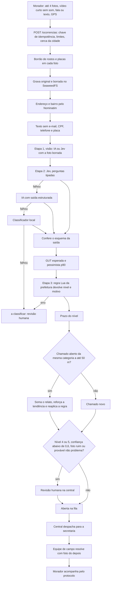

# Fluxo do agente de triagem

Versão técnica do fluxo descrito no [README](../README.md#como-o-agente-de-ia-funciona). Tudo aqui foi conferido no código em 15/11/2026. Quando o texto e o código divergirem, vale o código.

Decisões por trás deste fluxo: [ADR 0007](adr/0007-agente-de-triagem.md) (visão e Jev), [ADR 0010](adr/0010-protocolo-de-triagem-urbana.md) (GUT calibrada), [ADR 0015](adr/0015-midia-v2-varias-fotos-e-video.md) (mídia), [ADR 0020](adr/0020-envio-anonimo-e-idempotente.md) (envio idempotente), [ADR 0024](adr/0024-cadastro-do-morador-com-cpf.md) (cadastro do morador e filtro de espaço público) e [ADR 0016](adr/0016-ciclo-de-vida-papeis-e-equipe-de-campo.md) (ciclo do chamado).

## A ideia em uma frase
A IA faz julgamentos pequenos e tipados (que tipo de problema, há água jorrando, quão grave), cada um com probabilidade. Quem decide o nível de 1 a 5 é uma regra em Lua, escrita e editável pela prefeitura. Nível alto ou dúvida passam por uma pessoa.

## Diagrama


## Etapas
| # | Etapa | Referência no código | Entra | Sai | Tempo máximo | Se falhar |
|---|---|---|---|---|---|---|
| 1 | Recepção do envio | `ocorrencias/handlers.go`, `Criar` | multipart com `foto` (1 a 4), `video` (0 ou 1) e `quadro` (até 3), `lat`, `lng`, `precisao`, `categoria`, `texto`, `local_manual`; cabeçalhos `Idempotency-Key` e `X-Mogi-Aparelho` | relato aceito ou erro com código estável (`foto_formato`, `fora_da_cidade`, `muitos_envios`...) | corpo até cerca de 80 MB; leitura até 5 min | erro com frase para o morador; mesma chave devolve o mesmo recibo, com `repetido: true` |
| 2 | Borrão de rostos e placas | `midia/seletivo.go`, `BorradorSeletivo` | foto original (JPEG ou PNG, até 12 MB e 40 megapixels) | JPEG borrado | sem teto próprio; até 3 fotos borradas ao mesmo tempo | cai no borrão total (`BorradorConservador`); `BORRADOR=total` força o total |
| 3 | Armazenamento | `midia/midia.go` | original e borrada | chaves no SeaweedFS; a original nasce com data de apagar (90 dias) | dentro do envio | erro `midia_indisponivel`; o que subiu é apagado |
| 4 | Endereço e bairro | `geo/geo.go`, `Reverso` | lat e lng | endereço e bairro, com cache no banco | 5 s | segue sem endereço; o ponto no mapa vale |
| 5 | Texto sem dados pessoais | `triagem/tipos.go`, `SemDadosPessoais` | fala transcrita ou texto | texto com `[removido]` no lugar de e-mail, CPF, telefone e placa | instantâneo | não falha; é rede de segurança por padrão de texto, nomes próprios passam |
| 6 | Visão | `triagem/ia.go`, `Descrever` (IA) ou `triagem/jev.go`, `Descrever` (Jev com `JEV_FOTO=true`) | primeira foto borrada; a IA vê também até 2 fotos extras | `Descricao`: categoria, resumo, sinais visíveis, `foto_util` e já uma decisão sugerida | 20 s | segue sem descrição, só com categoria e texto |
| 7 | Classificação em cadeia | `triagem/servico.go`, `classificar`; adaptadores `Jev`, `IA`, `ClassificadorLocal` | `Entrada` (categoria escolhida, texto, bairro, descrição, foto borrada) | `Classificacao`: categoria, sinais, G, U e T, confiança, provedor, `problema_urbano` | 15 s por classificador; o Jev tem 10 s de cliente e uma nova tentativa em 429 ou 5xx | passa ao próximo da cadeia; se todos falharem, status `a_classificar` |
| 8 | Conferência do esquema | `triagem/servico.go`, `conferir` | saída de qualquer classificador | categoria conhecida, distribuições normalizadas, probabilidades entre 0 e 1 | instantâneo | conta como falha e aciona o próximo classificador |
| 9 | GUT | `triagem/gut.go`, `CalcularGUT` | distribuições G, U e T (com T reforçada pelos relatos) | GUT esperada, GUT pessimista (p90), médias de G, U e T | instantâneo | não falha |
| 10 | Regra Lua | `triagem/lua.go`, `MotorLua.Avaliar`; `backend/regras/itamogi/*.lua` | tabela `t` com `categoria`, `sinais`, `confianca`, `relatos`, `gut` | `{ nivel = 1 a 5, motivo = "..." }` | 50 ms, em sandbox | status `a_classificar` |
| 11 | Caminho e prazo | `triagem/servico.go`, `Triar` e `Prazo` | nível, confiança, descrição | status `revisao` ou `aberta`, prazo e fonte do prazo | instantâneo | não falha |
| 12 | Agrupamento e reavaliação | `ocorrencias/repositorio.go`, `Registrar`, `agrupar`, `somarRelato`; `triagem/servico.go`, `Reavaliar` | relato triado e o ponto | chamado novo ou relato somado a um chamado existente | uma transação, com trava por categoria | se a reavaliação falhar, o relato entra e a triagem antiga vale |
| 13 | Recibo e tempo real | `ocorrencias/repositorio.go`, `ReciboDe`; `temporeal/` | chamado gravado | recibo ao morador; evento por `LISTEN/NOTIFY` ao painel | o pino chega em cerca de 2 s (critério de aceite 3, a confirmar no campo) | o painel refaz a consulta ao reconectar |
| 14 | Revisão, despacho e resolução | `ocorrencias/handlers.go`: `Revisar`, `Despachar`, `Resolver`, `NaoEncontrado`, `Reabrir` | ações da central e da equipe de campo | transições de status, cada uma com linha em `eventos` | | ação recusada com `ErrTransicao` quando o status não permite |

Tempo total: a soma dos tetos passa da meta de 10 s da SPEC (RNF01), porque cada etapa tem a sua folga. No caso normal o Jev responde em centenas de milissegundos (medição abaixo). A latência média e o p95 reais aparecem nos Indicadores e na aba Operação. A triagem roda dentro do pedido de envio; a fila fora da requisição fica para quando o p95 passar de 8 s ([ADR 0021](adr/0021-cidade-como-dado-e-escala.md)).

## Quem decide o quê
| Decisão | Quem | Tipo |
|---|---|---|
| Tipo de problema, sinais de risco, G, U e T, se é mesmo um problema urbano | Jev, IA de reserva ou classificador local | IA, com probabilidade |
| Saída válida ou não | `conferir` em Go | determinística |
| Nível de 1 a 5 e o motivo | regra Lua da prefeitura | determinística e auditável |
| Prazo | `Prazo` em Go, pela escala proposta | determinística |
| Mesmo problema ou não | consulta PostGIS: mesma categoria, até 50 m, até 30 dias, não resolvido | determinística |
| Revisão humana | limiares fixos em Go | determinística |
| Nível final de 4 e 5, despacho, resolução | servidor da prefeitura | humana |

## As perguntas ao Jev
Todas ficam em `backend/internal/triagem/jev_perguntas.go`, num lugar só para auditar. Vão num pedido só a `POST /v1/systemone`, com `model: jev-latest`.

**Estado enviado:** cidade ("Itamogi-MG, cidade pequena do interior de Minas Gerais"), categoria escolhida pelo morador (se houver), relato já sem dados pessoais, bairro, descrição da foto feita pela visão e, com `JEV_FOTO=true`, a foto borrada (reduzida para caber entre 280 e 1568 pixels por lado). Nunca a foto original, a coordenada ou quem relatou.

| Pergunta | Tipo | O que se pergunta |
|---|---|---|
| `categoria` | escolha entre 9 | "Que tipo de problema urbano o morador está relatando?" Opções: água e esgoto, iluminação e energia, vias, limpeza urbana, árvores, sinalização de trânsito, calçadas e praças, animais, outros |
| `ha_problema` | sim ou não | "O relato mostra um problema de zeladoria num espaço público da cidade?" |
| `gravidade` | nota de 1 a 5 | "Qual o dano que este problema causa se nada for feito?" (de "só incomoda a aparência" a "põe em risco a vida") |
| `urgencia` | nota de 1 a 5 | "Quanto tempo a prefeitura pode esperar?" (de "rotina, sem prazo" a "ação imediata, em poucas horas") |
| `tendencia` | nota de 1 a 5 | "Como este problema muda com o tempo?" (de "fica igual" a "piora ou se espalha em poucas horas") |
| `sinal_*` | sim ou não, 10 perguntas | água jorrando, alagamento, perto de escola, creche ou posto, fio exposto, bloqueio da calçada, risco para moto, via bloqueada, árvore sobre fios, cruzamento movimentado, acessibilidade |

São 15 perguntas por relato. O código lê só os sinais da categoria escolhida. A confiança usada pela regra é a probabilidade da categoria escolhida.

## O esquema de saída da IA de reserva
`triagem/ia.go` chama um LLM com visão (modelo padrão `claude-opus-5-5`, configurável em `IA_MODELO`) com saída estruturada por JSON Schema e esforço baixo. O esquema exige todos os campos e não aceita campo extra:

```json
{
  "categoria": "agua | iluminacao | vias | limpeza | arvores | sinalizacao | calcadas | animais | outros",
  "resumo": "uma ou duas frases para o operador",
  "foto_util": true,
  "sinais": [{ "nome": "agua_jorrando", "probabilidade": 0.9 }],
  "g": { "n1": 0, "n2": 0, "n3": 0.1, "n4": 0.2, "n5": 0.7 },
  "u": { "n1": 0, "n2": 0, "n3": 0.1, "n4": 0.3, "n5": 0.6 },
  "t": { "n1": 0, "n2": 0.1, "n3": 0.3, "n4": 0.4, "n5": 0.2 },
  "confianca": 0.9
}
```

As instruções dizem ao modelo que a foto já está borrada, que não descreva pessoas, que trate o texto do morador como dado e não como ordem, e que espalhe a probabilidade quando houver dúvida. Numa chamada só a IA descreve e decide; se o Jev está na frente, ele usa o resumo e a decisão da IA vira o fallback.

## O classificador local
`triagem/local.go`. Não usa rede nem custa nada. Decide a categoria pela escolhida, pela vista na foto ou por palavras do relato ("cano", "poste", "buraco"...), e usa perfis fixos de G, U e T por categoria. Palavras como "jorr" ou "estour" levam o sinal de água jorrando a 0,93. Confiança 0,85 com categoria escolhida, 0,7 deduzida e 0,4 desconhecida. É a última rede antes de "a classificar" e é o que roda sem chave nenhuma.

## A regra da prefeitura em Lua
As regras de prioridade ficam em scripts Lua, um por categoria, em `backend/regras/itamogi/`: `_comum.lua` (faixas, limiares e a função comum), `agua.lua`, `arvores.lua`, `iluminacao.lua`, `sinalizacao.lua`, `vias.lua` e `padrao.lua` (para as categorias sem arquivo próprio).

**Como roda** (`backend/internal/triagem/lua.go`):
- O Go executa a regra com o [gopher-lua](https://github.com/yuin/gopher-lua) (Lua 5.1 em Go puro, MIT), num estado novo e isolado a cada triagem.
- Sandbox: só as bibliotecas `base`, `table`, `string` e `math`; `io`, `os`, `debug`, `require`, `load`, `dofile` e `print` ficam de fora, e `string.rep` também, para uma linha não estourar a memória. Cada execução tem limite de 50 ms (`TempoMaximoRegra`).
- O arquivo é lido a cada triagem: mudar um limiar vale no próximo relato, sem reiniciar o servidor nem fazer deploy.
- A regra precisa devolver `{ nivel = 1 a 5, motivo = "..." }`. Nível fora disso, erro ou tempo estourado viram "a classificar" e o chamado vai para uma pessoa.

**Como a prefeitura edita** (`backend/internal/admin/admin.go`): o gestor abre no painel Regras, aba Regras da triagem, muda o texto e testa. Antes de salvar, a regra nova roda na sandbox contra 13 cenários de referência (`triagem/simulacao.go`: cano estourado jorrando, fio caído, buraco grande na curva, lixo parado, árvore caída, semáforo apagado e outros) e a tela mostra o nível que cada um tiraria. Se algum cenário der erro, nada é salvo. Se passar, a versão vai para a tabela `regras_historico` com a cidade, o arquivo, o conteúdo e o login de quem mudou, e só então o arquivo é trocado.

**Por que Lua:** é uma linguagem pequena, feita para ser embutida em outros programas e segura de rodar em sandbox; é fácil de ler por um técnico da prefeitura que não é programador; e foi criada no Brasil, na PUC-Rio. Principalmente, separa as duas coisas: a IA dá o julgamento (o que é, quão grave, com que certeza) e a cidade escreve a decisão (que nível isso merece), num texto curto que qualquer auditor lê.

**Trecho real, copiado de `backend/regras/itamogi/`** (o primeiro bloco é parte de `_comum.lua`; a função `nivel_por_gut`, que percorre `FAIXAS`, fica no mesmo arquivo):

```lua
-- Faixas de GUT para nível, da maior para a menor.
FAIXAS = {
  { minimo = 100, nivel = 5 },
  { minimo = 60,  nivel = 4 },
  { minimo = 28,  nivel = 3 },
  { minimo = 9,   nivel = 2 },
  { minimo = 1,   nivel = 1 },
}

-- Sinal crítico com probabilidade acima disto trava o nível mínimo.
LIMIAR_SINAL = 0.8

-- Abaixo desta confiança, vale a GUT pessimista (na dúvida, sobe).
LIMIAR_CONFIANCA = 0.6

function avaliar_padrao(t, criticos)
  local gut, base = t.gut.esperado, "GUT esperada"
  if t.confianca < LIMIAR_CONFIANCA then
    gut, base = t.gut.p90, "GUT pessimista (p90) por confiança baixa"
  end
  local nivel = nivel_por_gut(gut)
  local motivo = string.format("%s %.0f, faixa do nível %d", base, gut, nivel)

  for _, c in ipairs(criticos or {}) do
    local p = t.sinais[c.sinal] or 0
    if p > LIMIAR_SINAL and c.nivel > nivel then
      nivel = c.nivel
      motivo = string.format("sinal %s com P %.2f acima de %.1f trava o nível %d",
        c.sinal, p, LIMIAR_SINAL, c.nivel)
    end
  end
  return { nivel = nivel, motivo = motivo }
end
```

```lua
-- Água e esgoto: cano estourado, vazamento, esgoto a céu aberto.
function avaliar(t)
  return avaliar_padrao(t, {
    { sinal = "agua_jorrando",   nivel = 5 },
    { sinal = "alagamento",      nivel = 5 },
    { sinal = "perto_de_escola", nivel = 4 },
  })
end
```

Linha a linha, em linguagem simples:
- `FAIXAS`: a tabela que transforma a nota GUT (de 1 a 125) em nível. 100 ou mais é nível 5; de 60 a 99, nível 4; e assim por diante. Mudar um número aqui muda a régua da cidade inteira.
- `LIMIAR_SINAL = 0.8`: um sinal de risco só conta se a IA tiver mais de 80% de certeza.
- `LIMIAR_CONFIANCA = 0.6`: abaixo de 60% de certeza sobre o tipo de problema, a regra usa o cenário pessimista.
- `local gut, base = t.gut.esperado, ...`: começa pela nota GUT esperada que o Go calculou.
- `if t.confianca < LIMIAR_CONFIANCA then ...`: na dúvida, troca pela nota pessimista (p90), que é mais alta. Na dúvida, a prioridade sobe.
- `local nivel = nivel_por_gut(gut)`: procura a faixa da nota em `FAIXAS`.
- `local motivo = string.format(...)`: escreve o porquê em uma frase, que o operador e o auditor leem no chamado.
- `for _, c in ipairs(criticos or {}) do`: passa pelos sinais críticos que a categoria listou.
- `if p > LIMIAR_SINAL and c.nivel > nivel then`: se o sinal está claro e pede um nível maior que o atual, o nível sobe para ele e o motivo passa a citar o sinal.
- `return { nivel = nivel, motivo = motivo }`: a resposta que o Go espera.
- Em `agua.lua`, `avaliar(t)` só diz quais sinais travam o nível em água e esgoto: água jorrando e alagamento travam 5, perto de escola trava 4. É aqui que a prefeitura decide, por exemplo, que esgoto perto de creche nunca fica abaixo de 4.

## Fórmulas
**GUT.** G, U e T são distribuições sobre as notas 1 a 5. A GUT esperada é o produto das médias: `E[G] x E[U] x E[T]`, de 1 a 125. A pessimista é o percentil 90 do produto, supondo as três independentes (`triagem/gut.go`). A esperada ordena a fila; a pessimista entra quando a confiança é baixa.

**Reavaliação com relatos extras.** Cada relato a mais do mesmo problema (agrupado ou "Também vi") desloca a tendência para cima: 35% da massa de cada nota sobe um degrau, das notas 4 para 5 até 1 para 2 (`Distribuicao.Reforcada`). A regra Lua roda de novo com a T nova e recebe `t.relatos`. O nível só sobe sozinho; se sobe para 4 ou 5 e o chamado estava aberto, ele volta para a revisão. Se o relato novo foi triado sozinho num nível mais alto, vale o mais alto. A fração de 35% é proposta a calibrar no piloto.

## Limiares
| Limiar | Valor | Onde | Efeito |
|---|---|---|---|
| Confiança | 0,6 | `servico.go` e `_comum.lua` | abaixo: revisão humana e GUT pessimista |
| Sim | 0,7 | `jev_perguntas.go` | sinal acima disso entra na lista de sinais vistos pela visão do Jev |
| Não | 0,3 | `jev_perguntas.go` | `ha_problema` abaixo disso: foto não serve ou não é problema, vai para revisão |
| Sinal crítico | 0,8 | `_comum.lua` | trava o nível mínimo do sinal |
| Nível com revisão | 4 e 5 | `servico.go` | sempre passam por uma pessoa |
| Agrupamento | 50 m e 30 dias | parâmetros da cidade | mesmo problema vira um chamado |

Todos são proposta a calibrar com relatos reais de Itamogi.

## Custo e latência por etapa
Cada etapa grava uma linha em `triagem_etapas` (migração `0002_producao.sql`): `etapa` (`borrao`, `armazenamento`, `geocodigo`, `visao`, `classificacao`, `regra_lua`), `provedor`, `ms`, `custo_brl`, `tokens_entrada`, `tokens_saida`, `ok` e `erro`. Uma tentativa que falhou também vira linha, então o fallback fica visível. O detalhe do chamado mostra essas linhas no bloco de detalhes da triagem (só para o gestor), os Indicadores somam custo e latência, e a aba Operação mostra falhas por etapa na última hora.

| Medição | Data | Resultado |
|---|---|---|
| Jev ao vivo, só texto, 11 casos | 15/11/2026 | 10 no nível esperado; custo total R$ 0,00339 (cerca de R$ 0,0003 por relato); tempo mediano 160 ms, máximo 227 ms |
| Jev com foto borrada | 15/11/2026 | cano estourado reconhecido com confiança 0,98 e água jorrando 0,89; buraco 0,99 e risco para moto 0,93; uma imagem que não é problema teve probabilidade de problema 0,36 e foi para a revisão humana |
| Custo com foto | 12/11/2026 | cerca de 2.900 tokens, cerca de R$ 0,0007 por relato (conversa de 11/11) |
| Meta da SPEC | | triagem em até 10 s e custo abaixo de R$ 0,05 por relato |

O preço do Jev usado no cálculo (US$ 0,042 por milhão de tokens de entrada) e o câmbio (`CAMBIO_USD_BRL=5.5`) estão marcados a confirmar no código. O custo da IA de reserva com o modelo padrão não foi medido com relatos reais (a confirmar).

## Exemplo ponta a ponta: cano estourado perto de escola
Os números de G, U, T e do sinal de escola abaixo são **ilustrativos**, escolhidos para mostrar as contas; a confiança 0,98 e a água jorrando 0,89 são da medição de 15/11.

1. **Entra.** A moradora abre `/relatar`, aponta a câmera, tira uma foto e fala "cano estourado jorrando água na frente da escola". O GPS vai junto. O app manda a foto, o texto, `lat`, `lng`, a precisão e uma `Idempotency-Key`.
2. **Borrão.** Um rosto de quem passava e a placa de um carro saem borrados; a original fica guardada só no servidor.
3. **Endereço.** O Nominatim devolve rua e bairro.
4. **Texto.** Sem telefone nem placa, o texto segue igual.
5. **Visão e classificação.** Sem `IA_CHAVE`, o próprio Jev vê a foto borrada (uma chamada só) e responde: categoria `agua` com 0,98; `ha_problema` 0,97; `sinal_agua_jorrando` 0,89; `sinal_perto_de_escola` 0,85; `sinal_alagamento` 0,20; G = (0; 0; 0,02; 0,18; 0,80), U = (0; 0; 0,05; 0,25; 0,70), T = (0; 0,05; 0,20; 0,50; 0,25).
6. **GUT.** E[G] = 4,78, E[U] = 4,65, E[T] = 3,95. GUT esperada = 87,8, faixa do nível 4. Pessimista (p90) = 125.
7. **Regra Lua.** Confiança 0,98 acima de 0,6, então vale a esperada: nível 4. O sinal `agua_jorrando` com 0,89 passa de 0,8 e trava o nível 5. Motivo gravado: "sinal agua_jorrando com P 0.89 acima de 0.8 trava o nível 5". O sinal de escola travaria 4, que já está abaixo.
8. **Caminho e prazo.** Nível 5: status `revisao`. Prazo padrão do nível 5: 2 horas, com a fonte "prazo padrão do nível, sem regra local".
9. **Agrupamento.** Não há chamado de água aberto a 50 m: nasce o chamado `MOGI-2026-000123` (número ilustrativo). Se um vizinho mandar outro relato do mesmo cano, a T vira (0; 0,03; 0,15; 0,40; 0,43), a GUT esperada sobe para 93,6 e o chamado mostra 2 relatos.
10. **Central.** O pino vermelho chega ao vivo no mapa com o som de crítico. O operador abre o detalhe, vê a foto borrada, "Água jorrando" em uma linha e confirma o nível com um toque. Depois despacha para a secretaria de Água e esgoto.
11. **Equipe.** A equipe abre `/campo`, toca em Rota, conserta, tira a foto do depois (também borrada) e marca como resolvido.
12. **O que a moradora vê.** Logo depois do envio: protocolo, nível 5, "a prefeitura vai conferir", prazo de 2 horas e o endereço do próprio ponto. Pelo link de acompanhamento: recebido, conferido, equipe a caminho e resolvido, com o que foi feito e a foto do depois. Ela nunca vê o texto ou a foto de outra pessoa.

## Métrica de qualidade
O operador que revisa confirma ou muda o nível; o painel compara o nível da IA (`nivel_ia`) com o final. Os Indicadores mostram revisados, exatos, até 1 nível de diferença, quantos o operador subiu e quantos baixou, e quantos caíram em "a classificar". A calibração por Brier e ECE (ADR 0010) ainda não está implementada (a fazer com os relatos do piloto).

## Agente de contexto: RAG e function calling
Decisão no [ADR 0023](adr/0023-agente-de-contexto-rag-e-function-calling.md); código em `backend/internal/conhecimento` e `backend/internal/triagem/contexto.go`.

| | Entrada | Lógica | Saída |
|---|---|---|---|
| **RAG** | texto do relato, resumo da visão, categoria, ponto | BM25 sobre a base da prefeitura (um Markdown por categoria) e busca de texto em português no histórico da cidade do último ano, com peso para a mesma categoria e para o que está a menos de 300 m | até 2 orientações e 3 casos parecidos (protocolo, urgência, status, resumo sem dado pessoal, distância arredondada), em até 800 ms |
| **Function calling** | pedido da IA de visão | `chamados_abertos_perto` (até 150 m), `buscar_casos_parecidos(descricao)` e `consultar_orientacao(categoria, pergunta)`; até 3 voltas, na última a IA tem de responder | resultado em JSON para o modelo, e o registro de cada chamada (nome, argumentos, tempo, erro) na trilha do chamado |

O contexto vai ao Jev no campo `contexto_da_prefeitura` e à IA dentro de `<contexto_da_prefeitura>`, sempre como referência: a foto e o relato continuam sendo a evidência principal. A coordenada nunca sai do servidor. Falha de contexto ou de função não derruba a triagem.

## O que ainda não existe
- **Prazos por norma local:** o RAG já traz orientações da prefeitura, mas o prazo ainda vem da escala padrão; ler prazos de normas que a prefeitura fornecer é o próximo passo.
- **Funções que escrevem** (abrir chamado, notificar o morador): as funções de hoje só leem; ação continua com a central.
- Pergunta de voz de volta quando falta informação, e calibração Brier e ECE.
