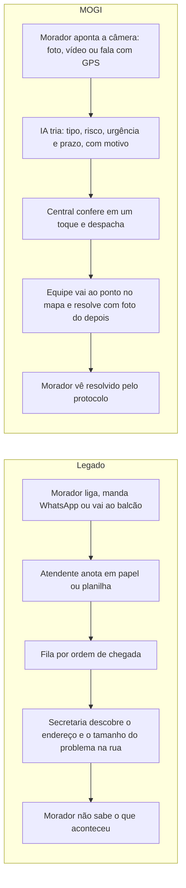
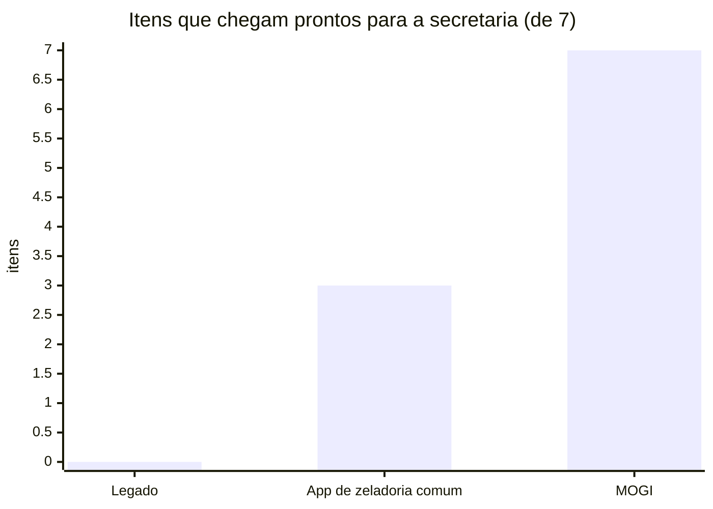
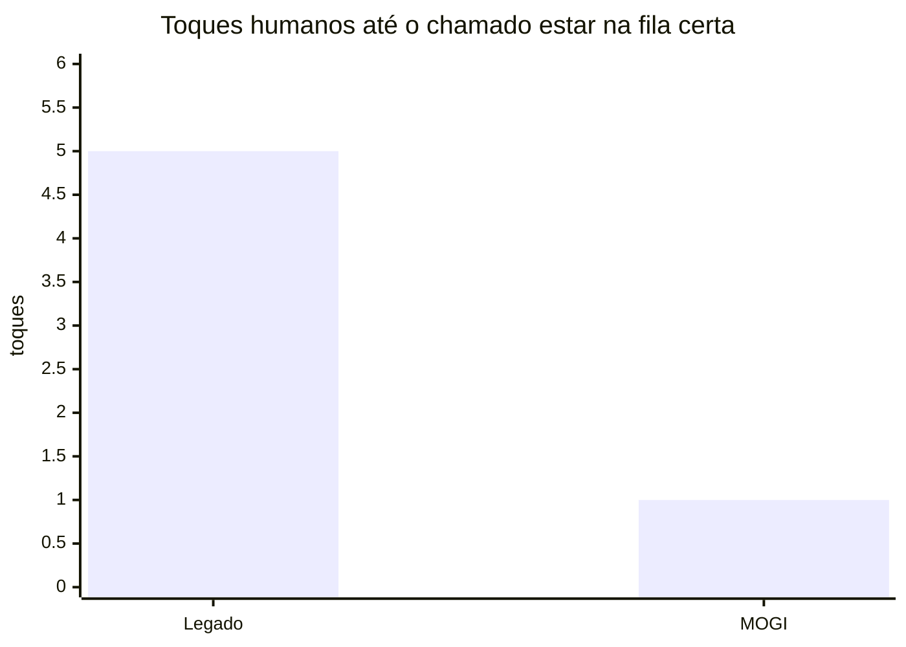
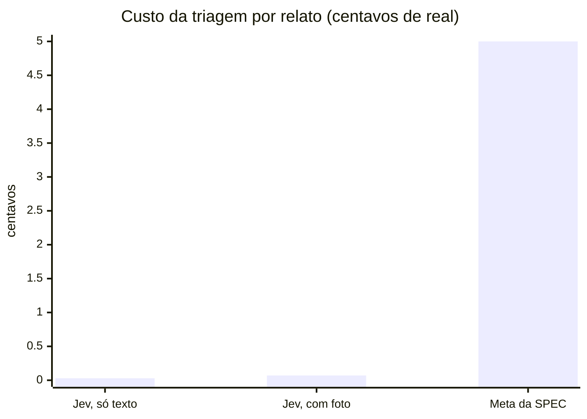
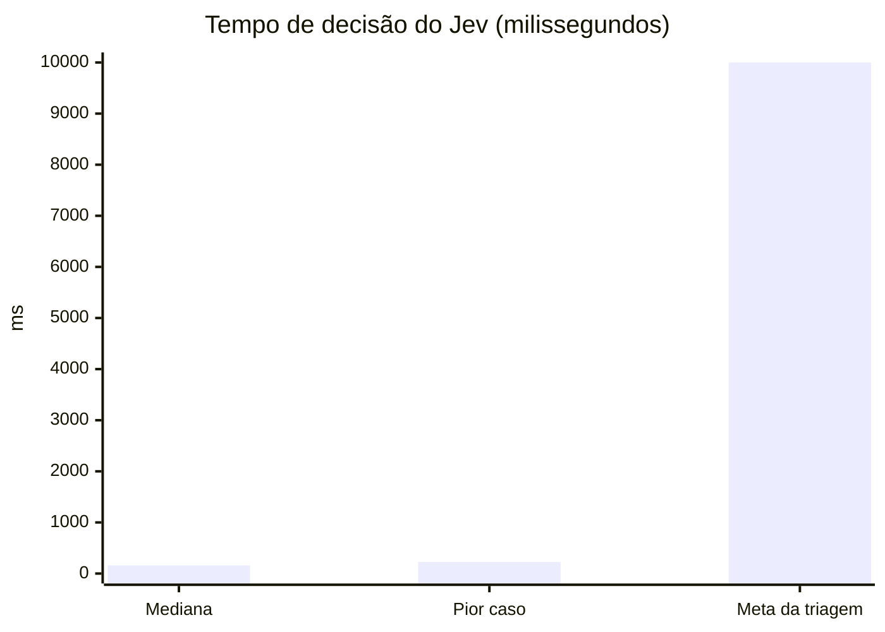
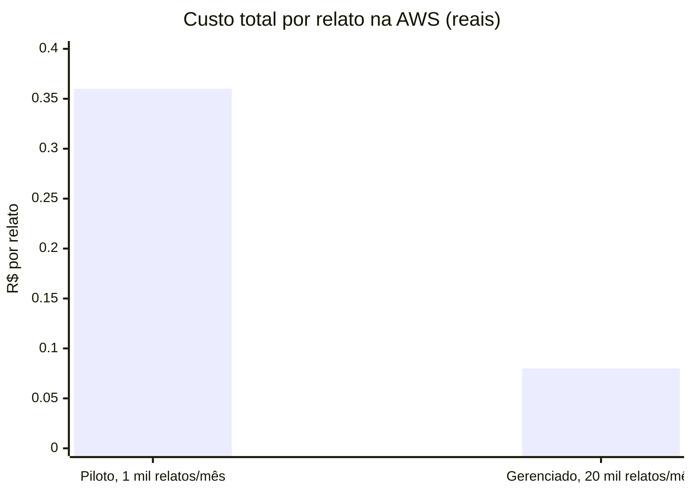

# MOGI frente ao atendimento legado

Por que o MOGI é diferente do que a maioria das prefeituras brasileiras usa hoje para zeladoria, o que o Jev acrescenta, como os três pilares da Rota Scale deixam a operação mais ágil e como a tecnologia usada para construir o sistema sustenta a escala.

> O retrato do "legado" abaixo é o padrão comum em cidades pequenas: telefone, balcão, WhatsApp da secretaria, e-mail da ouvidoria e planilha ou sistema de protocolo genérico. Ainda **vamos confirmar** como Itamogi atende hoje, na visita à prefeitura. Os números do MOGI são medidos; os do legado são descrições do fluxo, não estatísticas.

## Em uma frase
No legado, a prefeitura **recebe recados**. No MOGI, a prefeitura **recebe um chamado já triado**: com foto (rostos e placas protegidos), ponto no mapa, urgência explicada, prazo e secretaria certa, e o morador acompanha até a foto do serviço feito.

## Como cada um funciona

## Lado a lado

| | Legado (telefone, balcão, WhatsApp, planilha) | Apps de zeladoria comuns ([pesquisa](pesquisa-solucoes-semelhantes.md)) | **MOGI** |
|---|---|---|---|
| Como o morador relata | ligação no horário comercial, mensagem solta, formulário | foto e texto no app | **um toque na câmera**, com cadastro feito uma vez só; fala no lugar de digitar |
| Onde é o problema | endereço ditado, muitas vezes errado | ponto no mapa | **GPS do celular** ou ponto marcado, com cerca da cidade |
| Prova | nenhuma, ou foto solta no WhatsApp | foto | **até 4 fotos e vídeo de 15 s sem som**, com rostos e placas borrados |
| Quem decide a urgência | quem atende, no feeling | a prefeitura, à mão, ou votos | **IA + regra da prefeitura em Lua**, com motivo escrito; pessoa confere os casos graves |
| Ordem da fila | ordem de chegada | categoria ou votos | **urgência real (GUT calibrada)**, e cada novo relato no mesmo ponto reavalia |
| Duplicados | dez ligações viram dez anotações | às vezes, junção manual | **agrupados sozinhos** a até 50 m: viram "13 pessoas relataram" e sobem a urgência |
| Secretaria certa | o atendente encaminha | tabela por categoria | **automática pela categoria**, trocável no despacho |
| Equipe de campo | recebe papel ou ligação | nem sempre tem tela | **tela própria no celular**, só com os chamados dela, rota e foto do depois |
| Retorno ao morador | ligar de novo para perguntar | notificação genérica | **acompanhamento pelo protocolo**, com passos, prazo e foto do serviço |
| Privacidade | dados soltos em celulares e planilhas | varia | **CPF cifrado e mascarado**, borrão, original apagada em 90 dias, trilha de quem abriu o vídeo e o documento |
| Gestão | relatório montado à mão no fim do mês | painel do fornecedor | **indicadores ao vivo**, aba Operação, CSV, custo de cada triagem |
| Mudar uma regra | depende de fornecedor ou de memorando | depende do fornecedor | **o gestor edita e testa a regra Lua no painel**, vale no próximo chamado |
| Fora do ar | o telefone toca e ninguém anota | o app para | **cadeia de reserva**: Jev, IA, classificador local e, por último, uma pessoa |

## Dados e gráficos

Só números medidos no MOGI ou contados no próprio fluxo desenhado; nada inventado sobre o legado. A natureza de cada um está no [registro de evidências](evidencias.md).

**Quanto chega pronto para a secretaria.** Dos 7 itens que a secretaria precisa para agir (prova visual, ponto exato, urgência com motivo, prazo, secretaria certa, duplicados juntados, retorno ao morador), quantos o canal já entrega sem trabalho manual, contados na tabela acima:

**Toques humanos até o chamado estar na fila certa**, no fluxo desenhado de cada um. No legado: atender, anotar, descobrir o endereço, decidir a urgência, encaminhar. No MOGI: a central só confere (e nos níveis 1 a 3 com confiança alta, nem isso é obrigatório):

**Custo da triagem por relato, frente à meta da SPEC** (R$ 0,05). Medido com o Jev em 12 e 15/11/2026:

**Tempo da decisão do Jev, frente à meta de 10 s da triagem inteira.** Mediana de 160 ms e máximo de 227 ms em 11 casos (15/11/2026):

**Custo por relato cai com a escala** (infraestrutura AWS em São Paulo mais IA, [cotação](enterprise/07-aws.md)):

## Como o Jev empodera o sistema

O Jev, da TypeSafe AI, é um modelo de **decisão**, não de conversa. Ele recebe o estado do relato e responde perguntas fechadas, cada uma com probabilidade calibrada. É isso que torna a triagem confiável e barata o bastante para rodar em todo relato:

| O que o Jev faz | Por que muda o jogo | Medido no MOGI |
|---|---|---|
| Responde em formato fechado (escolha, sim ou não, nota de 1 a 5) | não inventa categoria nem quebra o formato: a regra da cidade sempre recebe o que espera | 15 perguntas tipadas por relato |
| Dá probabilidade calibrada, não um palpite | a regra usa o **cenário pessimista** quando há dúvida (como a triagem de Manchester nos hospitais) e manda para uma pessoa quando a confiança é baixa | 10 de 11 casos fictícios, escritos pelo time, no nível esperado (15/11) |
| Responde em fração de segundo | o morador recebe o recibo na hora | mediana de 160 ms |
| Custa quase nada | dá para **reavaliar a cada novo relato** no mesmo ponto | cerca de R$ 0,0003 por relato só com texto, R$ 0,0007 com foto |
| Vê a foto, com rostos e placas protegidos | reconhece o risco na imagem | cano estourado com confiança 0,98; foto que não era problema foi para revisão |

Com o RAG e o function calling ([ADR 0023](adr/0023-agente-de-contexto-rag-e-function-calling.md)), o Jev recebe também o critério da prefeitura e os casos parecidos da cidade, e o Claude, na etapa de visão, consulta se o problema já foi relatado ali antes de responder. O resultado é uma decisão **auditável**: o painel mostra as notas de G, U e T, os sinais, o motivo da regra e o que a IA consultou.

## Os três pilares e a agilidade da operação

| Pilar | O que o legado perde | O que o MOGI ganha | Efeito na operação |
|---|---|---|---|
| **Observabilidade** | ninguém sabe quantos pedidos entraram, quanto demorou nem onde travou | aba Operação com envios por minuto, tempo de resposta, falhas dos aparelhos, saúde do banco e da mídia, custo de cada triagem ([ADR 0019](adr/0019-observabilidade-minima.md)) | o problema aparece no mesmo dia: se o GPS falha num bairro ou a internet cai, o gestor vê e age |
| **Manutenibilidade** | cada ajuste depende de fornecedor, contrato ou nova versão | regra de prioridade em Lua, parâmetros e módulos que o gestor muda sem reiniciar; 23 ADRs; testes e CI em toda mudança ([ADR 0018](adr/0018-modulos-e-parametros-em-tempo-de-execucao.md)) | a prefeitura muda um prazo ou liga o vídeo **hoje**, e vale no próximo chamado |
| **Escalabilidade** | crescer é contratar mais atendentes | cidade como dado: nova cidade é uma linha no banco e uma pasta de regras; caminho de escala com gatilhos medidos ([ADR 0021](adr/0021-cidade-como-dado-e-escala.md)) | Itamogi primeiro, depois as cidades vizinhas, sem reescrever o sistema |

Juntos, os três pilares trocam o "anota e espera" por um ciclo curto: **relatou, triou, conferiu, despachou, resolveu, o morador viu**, com cada passo medido.

## Tecnologia de ponta e escala

- **IA em duas pontas.** Na triagem: Jev para decidir, Claude (Anthropic) para ver a foto e chamar funções, regra em Lua (linguagem criada na PUC-Rio) para a prefeitura ter a palavra final. Na construção: o sistema foi desenvolvido com o **Claude Code**, com agentes de IA trabalhando em paralelo no servidor, nas telas, na acessibilidade, nos sons e na documentação, sempre com revisão e testes.
- **Do zero ao piloto em duas semanas.** O primeiro commit é de 01/11/2026; em 15/11 o sistema tinha servidor, painel, app do morador na web e no Expo, tela da equipe de campo, RAG, function calling, observabilidade, CI e 23 ADRs.
- **Qualidade conferida por máquina.** Mais de 330 testes no painel, 31 no app, 70 testes Go, teste de fumaça e mais de 60 conferências contra banco e armazenamento reais em toda mudança.
- **Escala sem trocar de stack.** Go, Postgres com PostGIS e H3, armazenamento compatível com S3 e uma imagem Docker só: roda num servidor da prefeitura, numa VPS ou na AWS em São Paulo ([visão enterprise](enterprise/README.md)).
- **Custo que cabe no orçamento municipal.** Triagem por menos de 1 centavo por relato e infraestrutura de piloto em torno de R$ 360 por mês na nuvem ([cotação](enterprise/07-aws.md)).

## Quanto tempo isso devolve
Estimativa por etapa, em três tamanhos de demanda, com as contas abertas: [economia-de-tempo.md](economia-de-tempo.md). Com 400 pedidos por mês, cerca de 230 horas de servidor por mês, ou 1,4 pessoa em tempo integral (hipóteses a validar na visita).

## O que ainda falta provar
- Como Itamogi atende hoje e quanto tempo um pedido leva no fluxo atual (linha de base, a medir na visita).
- O acerto da triagem com relatos reais da cidade (teste de campo).
- A adoção pelos servidores: o MOGI foi desenhado para quem não tem tempo de treinamento ([ADR 0017](adr/0017-principios-de-produto.md)), e isso se confirma no uso.
