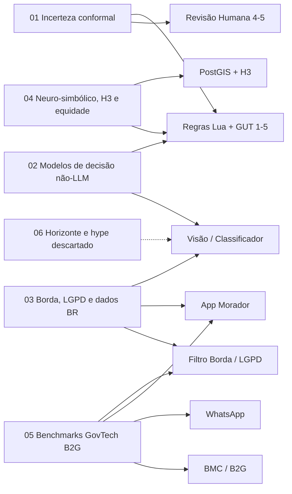
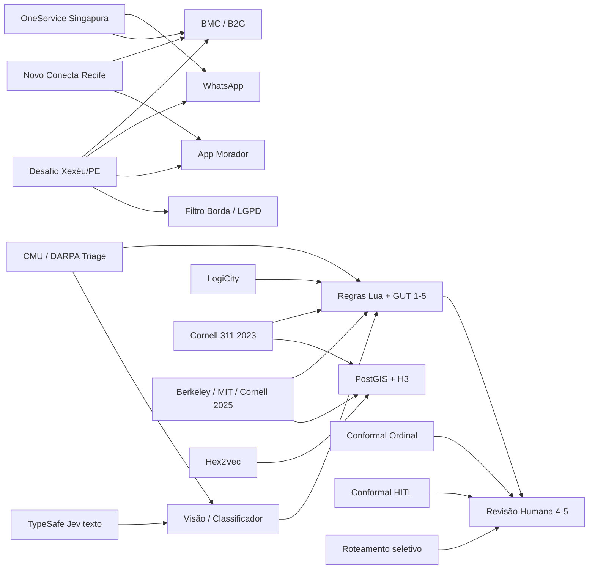

# Knowledge Graph P1 — Evidências acadêmicas e GovTech do Sistema MOGI

Pacote permanente de consulta para próximas releases, para o pitch da banca AKCIT e para o BMC. Consolida as pesquisas verificadas **RTLG-9** e **RTLG-10** (27/11/2026).

- Documento consolidado (diferenciação, banca e BMC): [P1-evidencias-ia-govtech-2026.md](P1-evidencias-ia-govtech-2026.md)
- Grafo programático (nós, arestas, hashtags): [knowledge-graph.json](knowledge-graph.json)
- Fichas por eixo: [eixos/](eixos/)

Nada neste diretório altera código, deploy ou a demo em produção. É evidência e roadmap, não um compromisso de entrega imediata.

## Como ler (separação obrigatória de status)

| Status | O que significa | O que NÃO significa |
|---|---|---|
| **Em produção na demo** | Está no fluxo documentado da demo atual (visão/descritor → Jev em texto → regras Lua → revisão humana nos níveis 4 e 5). | Que o Jev multimodal já é production-ready, ou que a TypeSafe faz fine-tune com dados do cliente. |
| **Roadmap Piloto 2027** | Candidato a entrar no piloto de Itamogi (1º semestre de 2027) com dados reais rotulados pela prefeitura. | Que já roda amanhã na banca ou que já foi treinado. |
| **Benchmark externo** | Edital, sistema ou paper que valida a dor, o escopo ou um risco (equidade, canal, métrica). | Que o MOGI copia a implementação ou compete no mesmo orçamento de metrópole. |
| **Horizonte** | Família promissora (world models, SSM) se o produto evoluir para vídeo ou inferência local de alta resolução. | Plano do piloto 2027. |
| **Descartado (hype)** | Fora do recorte do MOGI. Registrar para não citar como solução na banca. | Julgamento de qualidade acadêmica do paper. |

O **Score MOGI** (0–100) mede relevância e prioridade de consulta para este produto (camada de decisão não-LLM, cidade pequena, LGPD, pitch/BMC). Não é nota de qualidade do paper. Critérios: adequação à saída estruturada 1–5; viabilidade com poucos dados, on-prem ou DC nacional; impacto no pitch/BMC/banca; maturidade da evidência verificada; encaixe com Lua, GUT e H3.

Tiers: **P1-Crítico** 85–100 · **P1-Alto** 60–84 · **P2-Horizonte** 40–59 · **Descartado** 0–20.

Fontes, autores, anos, URLs e métricas deste pacote vêm exclusivamente das pesquisas verificadas. Não inventar referência nova aqui.

## Ranqueamento P1

Ordenado por Score MOGI. A família TypeSafe (System One, Jev 1.14, models/pricing) compartilha o rank 8; o documento de imagens entra à parte, porque o recurso é experimental.

| Rank | Score | Tier | Título / fonte | Região | Componente MOGI | Status | Hashtags | Link |
|---:|---:|---|---|---|---|---|---|---|
| 1 | 100 | P1-Crítico | Desafio Zeladoria Urbana — Prefeitura de Xexéu/PE (31/07/2026) | Brasil (PE) | BMC/B2G, App Morador, WhatsApp, LGPD, Lua, H3 | Benchmark externo | `#edital-pe` `#govtech-b2g` `#banca-akcit` `#lgpd-borda` | [edital](https://desafios.pe.gov.br/portal/home/getchallengedocument/337) |
| 2 | 97 | P1-Crítico | Novo Conecta (Recife / Emprel) | Brasil (PE) | BMC/B2G, App Morador | Benchmark externo | `#govtech-b2g` `#banca-akcit` | [Emprel](https://solucoes.emprel.gov.br/recife-lanca-novo-conecta-com-ia-servicos-personalizados-e-foco-em-inclusao/) |
| 3 | 95 | P1-Crítico | Multimodal Bayesian Triage (CMU / DARPA) | EUA / Polônia | Regras Lua + GUT, Visão/Classificador | Roadmap Piloto 2027 | `#neuro-simbolico` `#lua-regras` `#modelo-decisao` `#banca-akcit` | [arXiv:2512.18908](https://arxiv.org/abs/2512.18908) |
| 4 | 94 | P1-Crítico | LogiCity (CMU / University of Toronto) | EUA / Canadá | Regras Lua + GUT | Roadmap Piloto 2027 | `#neuro-simbolico` `#lua-regras` `#banca-akcit` | [arXiv:2411.00773](https://arxiv.org/abs/2411.00773) |
| 5 | 93 | P1-Crítico | Viés socioeconômico em relatos 311 (Cornell Tech, Nature Comp. Sci. 2023) | EUA | PostGIS + H3, Regras Lua (Tendência) | Benchmark externo | `#equidade-territorial` `#geoai-h3` `#lua-regras` `#banca-akcit` | [Nature](https://www.nature.com/articles/s43588-023-00572-6) |
| 6 | 92 | P1-Crítico | OneService (GovTech Singapura) | Singapura | WhatsApp, BMC/B2G | Benchmark externo | `#govtech-b2g` `#banca-akcit` | [GovTech](https://www.tech.gov.sg/technews/developing-the-one-service-chatbot/) |
| 7 | 91 | P1-Crítico | Conformal Ordinal | Internacional | Revisão Humana 4–5, Lua + GUT | Roadmap Piloto 2027 | `#conformal-prediction` `#revisao-humana-4-5` `#piloto-2027` `#banca-akcit` | [arXiv:2404.16610](https://arxiv.org/abs/2404.16610) |
| 8 | 90 | P1-Crítico | TypeSafe System One / Jev (docs oficiais de produto e preço) | EUA | Visão/Classificador (texto na demo) | Em produção na demo | `#modelo-decisao` `#nao-llm` `#banca-akcit` | [System One](https://docs.typesafe.ai/concepts/system-one) · [Jev 1.14](https://typesafe.ai/blog/jev-1-14) · [models](https://docs.typesafe.ai/models) |
| 9 | 89 | P1-Crítico | Inspeção urbana / 311 (Berkeley / MIT / Cornell, 2025) | EUA | PostGIS + H3, Regras Lua | Benchmark externo | `#equidade-territorial` `#geoai-h3` `#lua-regras` `#banca-akcit` | [arXiv:2506.08740](https://arxiv.org/abs/2506.08740) |
| 10 | 88 | P1-Crítico | Conformal Prediction com human-in-the-loop | Internacional | Revisão Humana 4–5 | Roadmap Piloto 2027 | `#conformal-prediction` `#revisao-humana-4-5` `#piloto-2027` | [arXiv:2401.13744](https://arxiv.org/abs/2401.13744) |
| 11 | 87 | P1-Crítico | Roteamento seletivo por incerteza conformal | Internacional | Revisão Humana 4–5 | Roadmap Piloto 2027 | `#conformal-prediction` `#revisao-humana-4-5` `#piloto-2027` | [arXiv:2509.12573](https://arxiv.org/abs/2509.12573) |
| 12 | 86 | P1-Crítico | Conformal Risk Control (ICLR 2024) | EUA | Revisão Humana 4–5 | Roadmap Piloto 2027 | `#conformal-prediction` `#revisao-humana-4-5` `#piloto-2027` | [arXiv:2208.02814](https://arxiv.org/abs/2208.02814) |
| 13 | 85 | P1-Crítico | Hex2Vec (Kraina AI; H3 + OSM) | Polônia | PostGIS + H3 | Roadmap Piloto 2027 | `#geoai-h3` `#equidade-territorial` `#piloto-2027` | [arXiv:2111.00970](https://arxiv.org/abs/2111.00970) |
| 14 | 84 | P1-Alto | Conformal Prediction (Angelopoulos & Bates) | EUA | Revisão Humana 4–5 | Roadmap Piloto 2027 | `#conformal-prediction` `#revisao-humana-4-5` `#piloto-2027` | [arXiv:2107.07511](https://arxiv.org/abs/2107.07511) |
| 15 | 83 | P1-Alto | SigLIP 2 (Google DeepMind) | EUA / Reino Unido | Visão/Classificador | Roadmap Piloto 2027 | `#nao-llm` `#edge-vision` `#modelo-decisao` `#piloto-2027` | [arXiv:2502.14786](https://arxiv.org/abs/2502.14786) |
| 16 | 82 | P1-Alto | DINOv3 (Meta FAIR) | EUA / França | Visão/Classificador | Roadmap Piloto 2027 | `#nao-llm` `#edge-vision` `#piloto-2027` | [arXiv:2508.10104](https://arxiv.org/abs/2508.10104) |
| 17 | 81 | P1-Alto | MobileCLIP2 (Apple) | EUA | Filtro Borda/LGPD, App Morador | Roadmap Piloto 2027 | `#edge-vision` `#lgpd-borda` `#piloto-2027` | [arXiv:2508.20691](https://arxiv.org/abs/2508.20691) |
| 18 | 80 | P1-Alto | TabPFN-2.5 (Prior Labs) | Europa | Visão/Classificador | Roadmap Piloto 2027 | `#few-shot-tabular` `#nao-llm` `#modelo-decisao` `#piloto-2027` | [arXiv:2511.08667](https://arxiv.org/abs/2511.08667) |
| 19 | 79 | P1-Alto | TabPFN v2 (Nature 2025) | Europa | Visão/Classificador | Roadmap Piloto 2027 | `#few-shot-tabular` `#nao-llm` `#modelo-decisao` `#piloto-2027` | [Nature](https://www.nature.com/articles/s41586-024-08328-6) |
| 20 | 78 | P1-Alto | Places365 (MIT) | EUA | Filtro Borda/LGPD | Roadmap Piloto 2027 | `#edge-vision` `#lgpd-borda` `#piloto-2027` | [GitHub](https://github.com/CSAILVision/places365) |
| 21 | 77 | P1-Alto | Auto311 (Vanderbilt / Nashville) | EUA | BMC/B2G, Visão/Classificador | Benchmark externo | `#govtech-b2g` `#modelo-decisao` `#banca-akcit` | [arXiv:2312.14185](https://arxiv.org/abs/2312.14185) |
| 22 | 76 | P1-Alto | BR-AsPavDam (Cascavel-PR, DNIT, CC-BY 4.0) | Brasil (PR) | Visão/Classificador | Roadmap Piloto 2027 | `#dataset-br` `#piloto-2027` `#edge-vision` | [Zenodo](https://doi.org/10.5281/zenodo.16291115) |
| 23 | 75 | P1-Alto | TabICL (Inria) | França | Visão/Classificador | Roadmap Piloto 2027 | `#few-shot-tabular` `#nao-llm` `#piloto-2027` | [arXiv:2502.05564](https://arxiv.org/abs/2502.05564) |
| 24 | 74 | P1-Alto | MobileCLIP (Apple, CVPR 2024) | EUA | Filtro Borda/LGPD | Roadmap Piloto 2027 | `#edge-vision` `#lgpd-borda` `#piloto-2027` | [arXiv:2311.17049](https://arxiv.org/abs/2311.17049) |
| 25 | 73 | P1-Alto | RDD2022 | Internacional | Visão/Classificador | Roadmap Piloto 2027 | `#dataset-br` `#piloto-2027` `#edge-vision` | [arXiv:2209.08538](https://arxiv.org/abs/2209.08538) |
| 26 | 72 | P1-Alto | EgoBlur (Meta) | EUA | Filtro Borda/LGPD | Roadmap Piloto 2027 | `#lgpd-borda` `#piloto-2027` | [arXiv:2308.13093](https://arxiv.org/abs/2308.13093) |
| 27 | 71 | P1-Alto | Snorkel (Stanford) | EUA | Visão/Classificador (rotulagem) | Roadmap Piloto 2027 | `#dataset-br` `#piloto-2027` `#few-shot-tabular` | [arXiv:1711.10160](https://arxiv.org/abs/1711.10160) |
| 29 | 69 | P1-Alto | TypeSafe Jev — docs de imagens (recurso experimental) | EUA | Visão/Classificador | Em produção na demo (recurso experimental) | `#modelo-decisao` `#nao-llm` | [images](https://docs.typesafe.ai/images) |
| 28 | 70 | P1-Alto | ModernBERT (Answer.AI / LightOn) | Internacional | Visão/Classificador (texto/metadados) | Roadmap Piloto 2027 | `#nao-llm` `#modelo-decisao` `#piloto-2027` | [arXiv:2412.13663](https://arxiv.org/abs/2412.13663) |
| 30 | 68 | P1-Alto | RT-DETRv2 (Baidu) | China | Visão/Classificador | Roadmap Piloto 2027 | `#nao-llm` `#edge-vision` `#piloto-2027` | [arXiv:2407.17140](https://arxiv.org/abs/2407.17140) |
| 31 | 66 | P1-Alto | YOLO-World (Tencent, CVPR 2024) | China | Visão/Classificador | Roadmap Piloto 2027 | `#nao-llm` `#edge-vision` `#piloto-2027` | [arXiv:2401.17270](https://arxiv.org/abs/2401.17270) |
| 32 | 64 | P1-Alto | YOLOE (Tsinghua, ICCV 2025) | China | Visão/Classificador | Roadmap Piloto 2027 | `#nao-llm` `#edge-vision` `#piloto-2027` | [arXiv:2503.07465](https://arxiv.org/abs/2503.07465) |
| 33 | 58 | P2-Horizonte | V-JEPA 2 (Meta FAIR) | EUA | Visão/Classificador (vídeo, futuro) | Horizonte | `#world-model` `#nao-llm` | [arXiv:2506.09985](https://arxiv.org/abs/2506.09985) |
| 34 | 54 | P2-Horizonte | V-JEPA (Meta FAIR / Inria) | EUA / França | Visão/Classificador (futuro) | Horizonte | `#world-model` `#nao-llm` | [arXiv:2404.08471](https://arxiv.org/abs/2404.08471) |
| 35 | 50 | P2-Horizonte | I-JEPA (Meta FAIR, CVPR 2023) | EUA | Visão/Classificador (futuro) | Horizonte | `#world-model` `#nao-llm` | [arXiv:2301.08243](https://arxiv.org/abs/2301.08243) |
| 36 | 48 | P2-Horizonte | M3-JEPA | Internacional | Visão/Classificador (futuro) | Horizonte | `#world-model` `#nao-llm` | [arXiv:2409.05929](https://arxiv.org/abs/2409.05929) |
| 37 | 46 | P2-Horizonte | TI-JEPA | Internacional | Visão/Classificador (futuro) | Horizonte | `#world-model` `#nao-llm` | [arXiv:2503.06380](https://arxiv.org/abs/2503.06380) |
| 38 | 44 | P2-Horizonte | VMamba | Internacional | Visão/Classificador (infra futura) | Horizonte | `#ssm-vision` `#nao-llm` | [arXiv:2401.10166](https://arxiv.org/abs/2401.10166) |
| 39 | 42 | P2-Horizonte | MambaVision (NVIDIA) | EUA | Visão/Classificador (infra futura) | Horizonte | `#ssm-vision` `#nao-llm` | [arXiv:2407.08083](https://arxiv.org/abs/2407.08083) |
| 40 | 18 | Descartado | Grounding DINO (IDEA Research) — uso em tempo real sem GPU | Internacional | — | Descartado (hype) | `#descartado-hype` `#edge-vision` | [arXiv:2303.05499](https://arxiv.org/abs/2303.05499) |
| 41 | 12 | Descartado | UrbanCLIP | Internacional | — | Descartado (hype) | `#descartado-hype` | [arXiv:2310.18340](https://arxiv.org/abs/2310.18340) |
| 42 | 10 | Descartado | GeoCLIP | Internacional | — | Descartado (hype) | `#descartado-hype` | [arXiv:2309.16020](https://arxiv.org/abs/2309.16020) |
| 43 | 8 | Descartado | Liquid Neural Networks | EUA | — | Descartado (hype) | `#descartado-hype` | [arXiv:2006.04439](https://arxiv.org/abs/2006.04439) |

Notas de leitura rápida:

- Rank 8 é o motor **atual** da demo em texto (US$ 0,042 / milhão de tokens de entrada, saída grátis). Rank 29 é o aviso oficial de que imagem no Jev ainda é experimental.
- EgoBlur (rank 26) só entra em produção depois da checagem de licença.
- FPS publicados de RT-DETRv2, YOLO-World e YOLOE são em GPU, não em CPU do piloto.
- Não atribuir os nomes JEPA, SigLIP, DINOv3 ou Conformal à fala do Állan na mentoria de 27/11/2026. Ele referenciou a **classe** de modelos de decisão multimodais (na linha do Jev), não esses papers.

## Índice de hashtags vinculadas

Use as tags para cruzar fichas, o JSON e buscas no repositório. Cada tag aponta para o eixo principal e para as fontes.

| Hashtag | Significado no MOGI | Eixo | Fontes (ids no JSON) |
|---|---|---|---|
| `#nao-llm` | Arquiteturas que não geram texto livre; saída estruturada ou representação | [02](eixos/02-modelos-decisao-encoders-nao-llm.md), [06](eixos/06-horizonte-e-hype-descartado.md) | TypeSafe, SigLIP 2, DINOv3, ModernBERT, TabPFN, TabICL, detectores, família JEPA, SSM |
| `#modelo-decisao` | Motor de classificação/priorização tipado (1–5, categoria, sinais) | [02](eixos/02-modelos-decisao-encoders-nao-llm.md) | TypeSafe, TabPFN, SigLIP 2, Auto311, CMU/DARPA |
| `#neuro-simbolico` | Percepção neural + regras determinísticas da prefeitura | [04](eixos/04-neuro-simbolico-geoai-equidade.md) | LogiCity, CMU/DARPA Triage |
| `#lua-regras` | Política pública auditável em Lua (gopher-lua), matriz GUT | [04](eixos/04-neuro-simbolico-geoai-equidade.md) | LogiCity, CMU/DARPA, Cornell 2023, Berkeley/MIT/Cornell 2025 |
| `#conformal-prediction` | Calibração com garantia estatística, conjuntos de notas, controle de risco | [01](eixos/01-incerteza-conformal.md) | Angelopoulos & Bates, Risk Control, Ordinal, HITL, Selective Routing |
| `#revisao-humana-4-5` | Níveis 4 e 5 sobem para o servidor; casos ambíguos também | [01](eixos/01-incerteza-conformal.md) | família conformal |
| `#geoai-h3` | Agrupamento e contexto territorial em hexágonos H3 | [04](eixos/04-neuro-simbolico-geoai-equidade.md) | Hex2Vec, Cornell 2023, Berkeley/MIT/Cornell 2025 |
| `#equidade-territorial` | Corrigir o viés de bairros que reportam mais | [04](eixos/04-neuro-simbolico-geoai-equidade.md) | Cornell 2023, Berkeley/MIT/Cornell 2025, Hex2Vec |
| `#edge-vision` | Visão leve no aparelho ou em servidor enxuto | [03](eixos/03-edge-privacidade-dados-br.md), [02](eixos/02-modelos-decisao-encoders-nao-llm.md) | MobileCLIP(2), Places365, SigLIP 2, DINOv3, detectores, datasets |
| `#lgpd-borda` | Filtro e borrão antes do upload; menos PII saindo do aparelho | [03](eixos/03-edge-privacidade-dados-br.md) | MobileCLIP2, Places365, EgoBlur, edital Xexéu |
| `#dataset-br` | Dados abertos brasileiros ou de dano viário para o piloto | [03](eixos/03-edge-privacidade-dados-br.md) | BR-AsPavDam, RDD2022, Snorkel |
| `#few-shot-tabular` | Cabeça de decisão treinável com centenas/milhares de linhas | [02](eixos/02-modelos-decisao-encoders-nao-llm.md) | TabPFN v2, TabPFN-2.5, TabICL, Snorkel |
| `#govtech-b2g` | Sistemas e canais de governo que validam o modelo de negócio | [05](eixos/05-benchmarks-govtech-b2g.md) | Xexéu, Recife, Singapura, Auto311 |
| `#edital-pe` | Edital público de Pernambuco com escopo quase idêntico ao MOGI | [05](eixos/05-benchmarks-govtech-b2g.md) | Desafio Xexéu/PE |
| `#world-model` | Previsão em espaço latente, sem gerar tokens/pixels; horizonte de vídeo | [06](eixos/06-horizonte-e-hype-descartado.md) | I-JEPA, V-JEPA, V-JEPA 2, M3-JEPA, TI-JEPA |
| `#ssm-vision` | Backbones State Space para visão em alta resolução (horizonte) | [06](eixos/06-horizonte-e-hype-descartado.md) | VMamba, MambaVision |
| `#piloto-2027` | Itens do salto planejado para o piloto de Itamogi | [P1](P1-evidencias-ia-govtech-2026.md) | encoders, conformal, edge, tabular, datasets, Hex2Vec |
| `#banca-akcit` | Argumento pronto ou evidência para a banca | [P1](P1-evidencias-ia-govtech-2026.md) | Xexéu, Recife, Singapura, neuro-simbólico, equidade, conformal, TypeSafe |
| `#descartado-hype` | Não citar como solução do MOGI | [06](eixos/06-horizonte-e-hype-descartado.md) | Liquid NN, UrbanCLIP, GeoCLIP, Grounding DINO em tempo real sem GPU |

## Grafo visual

Os dois diagramas abaixo ligam eixos e fontes aos módulos reais do MOGI. A versão completa e consultável por agentes está em [knowledge-graph.json](knowledge-graph.json) (`nodes` + `edges`).

### Eixos → módulos do MOGI

### Fontes P1-Crítico → módulos do MOGI

## Fichas por eixo

| Ficha | Status predominante | Consultar quando |
|---|---|---|
| [01 — Incerteza conformal](eixos/01-incerteza-conformal.md) | Roadmap Piloto 2027 | Revisão humana nos níveis 4 e 5, calibração, “não é corte no chute” |
| [02 — Modelos de decisão e encoders não-LLM](eixos/02-modelos-decisao-encoders-nao-llm.md) | Demo (Jev texto) + Roadmap 2027 | Alternativa ao captioner/LLM, limites reais do Jev, late fusion |
| [03 — Borda, privacidade e dados BR](eixos/03-edge-privacidade-dados-br.md) | Roadmap Piloto 2027 | LGPD na origem, filtro indoor, datasets e rotulagem |
| [04 — Neuro-simbólico, GeoAI e equidade](eixos/04-neuro-simbolico-geoai-equidade.md) | Roadmap + Benchmark | “IA sugere, a prefeitura decide”, H3, viés territorial |
| [05 — Benchmarks GovTech B2G](eixos/05-benchmarks-govtech-b2g.md) | Benchmark externo | Banca, BMC, edital de PE, Recife, Singapura, Auto311 |
| [06 — Horizonte e hype descartado](eixos/06-horizonte-e-hype-descartado.md) | Horizonte / Descartado | Vídeo futuro, o que não citar na banca |

## Estatísticas do grafo

Valores gerados a partir de `knowledge-graph.json` em 27/11/2026:

- 59 nós no total: 45 fontes, 6 eixos, 8 módulos do MOGI
- 136 arestas
- 19 hashtags controladas
- 43 linhas no ranqueamento (a família TypeSafe de produto/preço compartilha o rank 8)

## Levantamento de requisitos e infra (27/11/2026)

Complemento do mesmo dia, fora do grafo acadêmico deste diretório. O `knowledge-graph.json` não foi alterado (continuam 59 nós, 136 arestas e 19 hashtags).

- Requisitos do MVP (WhatsApp demonstrável, polish da UI, landing com QR e LGPD, pitch e B2G): [../requisitos/levantamento-mvp-2026-11-27.md](../requisitos/levantamento-mvp-2026-11-27.md)
- Três degraus de infra, números com fonte e regra legal (LGPD art. 33, IN GSI/PR 5/2021 e Portaria SGD/MGI 5.950/2023): [../requisitos/infra-escalonamento-2026-11-27.md](../requisitos/infra-escalonamento-2026-11-27.md)

Nada nesses dois arquivos altera código, deploy ou a demo em produção.

## Relação com o restante do repositório

- Decisão atual de triagem (não substituída por este pacote): [ADR 0007](../adr/0007-agente-de-triagem.md) e [fluxo do agente](../fluxo-do-agente.md)
- Inovação já escrita para o hackathon: [inovacao-e-diferenciais.md](../inovacao-e-diferenciais.md)
- BMC: [../../bmc/README.md](../../bmc/README.md)
- Pitch e perguntas da banca: [../../pitch/README.md](../../pitch/README.md)
