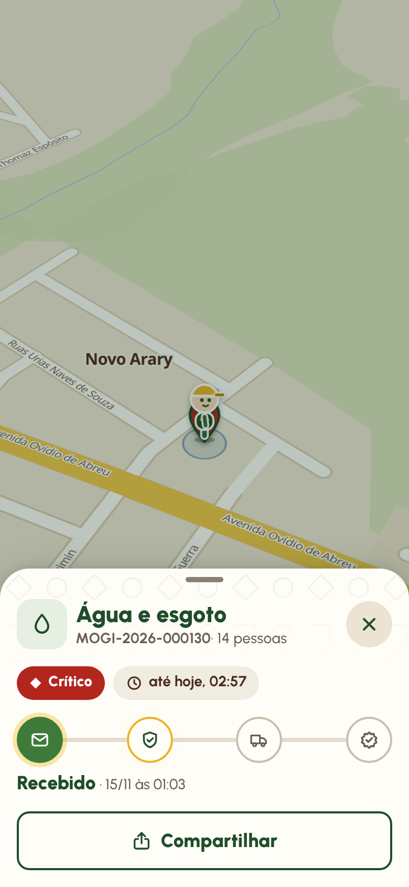
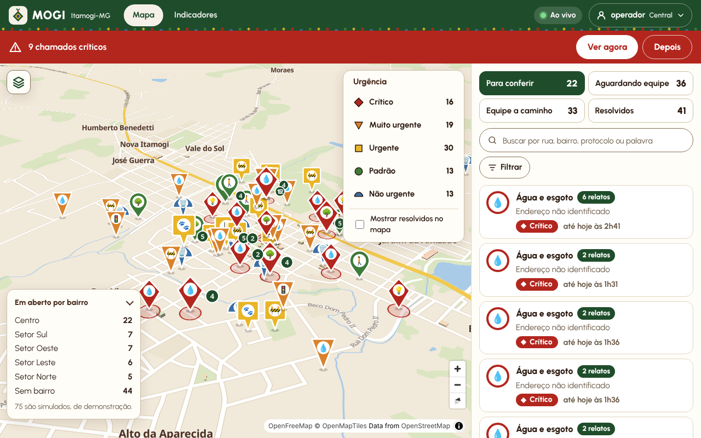

<!-- _class: dark -->

## MOGI  /  Problema

# Qual chamado pode esperar?

Um cano estourou perto de uma escola. Também chegaram pedidos de coleta e de reparo de um poste.

**Quem atende o telefone precisa decidir para onde mandar a equipe primeiro.**

<!-- 0:00–0:20 · Renan. Imagine os três pedidos chegando por telefone ou mensagem. Qual deles tem água jorrando? Qual é o endereço certo? Quem já mandou alguém até lá? Quando essas informações ficam espalhadas, ordenar a fila depende de ligar de volta. É essa decisão que o MOGI ajuda a tomar. -->

---

## Solução

# Do primeiro relato à foto do conserto

O morador envia foto e localização. A prefeitura recebe o chamado com **prioridade e motivo**. Pelo protocolo, o morador acompanha o que aconteceu.

Tela do protótipo com dados de demonstração.

<!-- 0:20–0:40 · Renan. Para quem mora na cidade, basta abrir o link e mostrar o problema. Para quem trabalha na central, muda o que chega à mesa. Há um ponto no mapa, uma descrição e uma prioridade que a pessoa pode conferir. Russo vai mostrar o caminho de um único chamado. -->

---

## Funcionamento / MVP

# Um protocolo, quatro passos

**Morador** envia a foto.\
**Central** confere a urgência e despacha.\
**Equipe** registra o conserto.\
**Morador** recebe a atualização.

Painel do protótipo com dados de demonstração.

<!-- 0:40–1:50 · Russo. Abrir o relato de teste com foto protegida. Mostrar o protocolo. Abrir o mesmo chamado na central e explicar o motivo da prioridade. Na seção O que a IA consultou, distinguir Base, Caso e Função. Só dizer que Claude chamou uma ferramenta se houver a linha Função com sucesso. Despachar para a equipe, registrar a resolução e voltar ao acompanhamento do morador. Se usar gravação, identificá-la. -->

---

## Funcionamento / Evidência

# Quem dá a prioridade?

Claude interpreta a foto protegida. Jev classifica os sinais de risco. **A regra da prefeitura define o nível.** Uma pessoa confere os casos críticos.

**10 de 11** relatos de texto receberam o nível esperado no teste do time com Jev.

Fonte · Teste de 15/11/2026, casos fictícios escritos pela equipe. Registro em docs/evidencias.md.

<!-- 1:50–2:15 · Russo. A orquestração separa percepção, classificação e decisão. O RAG recupera orientações e casos semelhantes. Claude pode solicitar uma consulta adicional por function calling. Em cada protocolo conseguimos conferir o que ocorreu. Os dez acertos que mostramos são do teste com Jev, feito com exemplos escritos por nós. O desempenho com moradores ainda será medido. -->

---

## Mercado

# Quem usa e quem compra?

**Quem usa** · Moradores, central de atendimento e equipes de rua.

**Quem pode contratar** · Prefeituras pequenas com equipes compartilhadas entre bairros. Consórcios são uma possibilidade de expansão.

**Primeira conversa** · O prefeito de Itamogi avaliou o protótipo em 18/11. O piloto ainda depende de acordo.

<!-- 2:15–2:30 · Renan. Começamos pela prefeitura pequena porque uma mesma equipe precisa atender prioridades concorrentes. A conversa em Itamogi abriu espaço para avaliar o protótipo. O próximo passo comercial é verificar quem decide a contratação e quanto custa hoje fazer essa triagem. Fonte da visita: docs/evidencias.md. -->

---

## Modelo de negócio

# Assinatura por município

**Hipótese de receita** · Assinatura anual e taxa de implantação. O morador usa gratuitamente.

A implantação inclui configurar as regras locais e treinar a central. A operação envolve hospedagem, chamadas de IA e suporte.

**Preço e disposição a pagar ainda precisam de validação.**

<!-- 2:30–2:43 · Renan. A hipótese é cobrar de quem opera o serviço. A assinatura cobre a operação e a implantação adapta a triagem à realidade local. Vamos validar o preço com a prefeitura e medir o custo conjunto de Claude e Jev. Fonte: bmc/README.md. -->

---

<!-- _class: dark -->

## O que precisamos / Próximos passos

# Uma central e uma equipe de rua para testar o ciclo completo

Pedimos à banca uma **ponte com uma prefeitura** disposta a conduzir um piloto acompanhado.

Com a autorização municipal, vamos comparar a prioridade com a avaliação do operador e medir o tempo entre o relato e o despacho.

<!-- 2:43–3:00 · Renan. Nosso pedido é uma apresentação à secretaria que recebe esses chamados. Com um responsável na central e outro em campo, podemos combinar as condições de privacidade, acompanhar relatos reais e devolver à prefeitura o que mudou no tempo e na qualidade da triagem. Encerrar aqui. O slide seguinte é reserva. -->

---

<!-- _class: notes -->

## Reserva / Perguntas da banca

# O que já podemos sustentar

**Privacidade e CPF.** Foto protegida e texto limpo seguem para a IA. CPF cifrado vincula cadastro e histórico. Validar o borrão com fotos reais antes do piloto.

**Custo.** Cerca de R$ 0,0003 por relato de texto no teste do Jev em 15/11, com 11 casos fictícios. Falta medir o fluxo completo com Claude.

**Por que combinar modelos e Lua?** Modelos interpretam sinais. A regra municipal em Lua define o nível, registra o motivo e pode ser testada pela prefeitura.

**RAG, ferramentas e multiagentes.** Busca lexical de orientações e casos. Claude pode pedir consultas de leitura. Há papéis especializados e coordenação central. A autonomia demonstrável é a escolha de ferramenta.

**Escala, simulação e aceite.** Uma instalação por cidade, com regras locais. As telas usam dados de demonstração. Em Itamogi houve avaliação do protótipo. O acordo de piloto e o teste com moradores seguem pendentes.

<!-- Referências para consulta: docs/evidencias.md, bmc/README.md, docs/fluxo-do-agente.md, docs/sops/06-checklist-lgpd.md e estudo do curso na PR 5. A evidência de custo não mede o custo total de operação. A ligação entre agentes não demonstra negociação autônoma. -->
